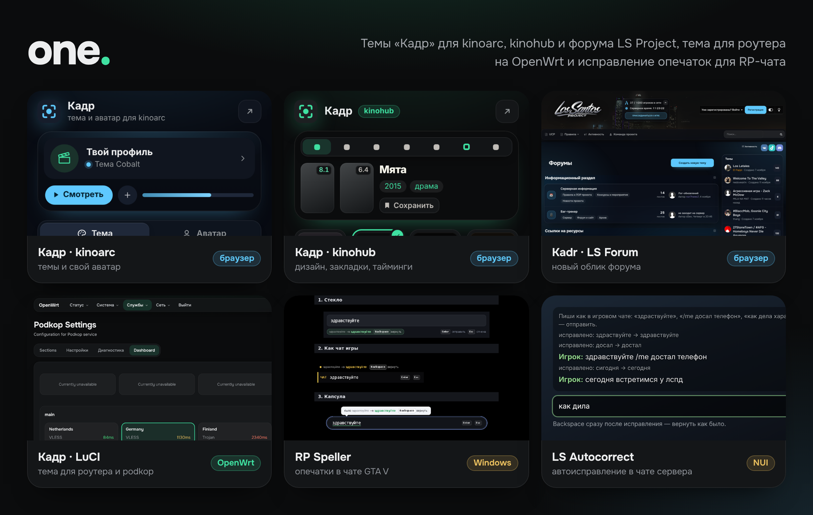
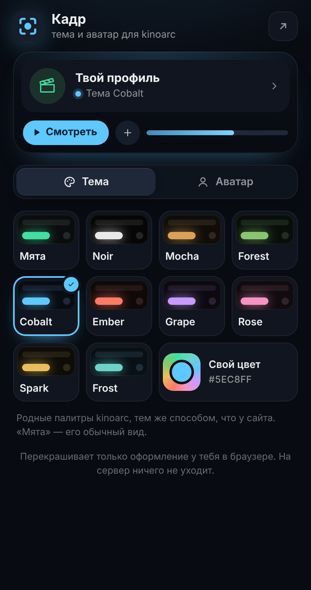
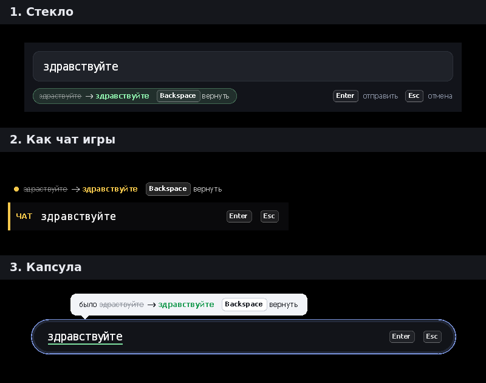
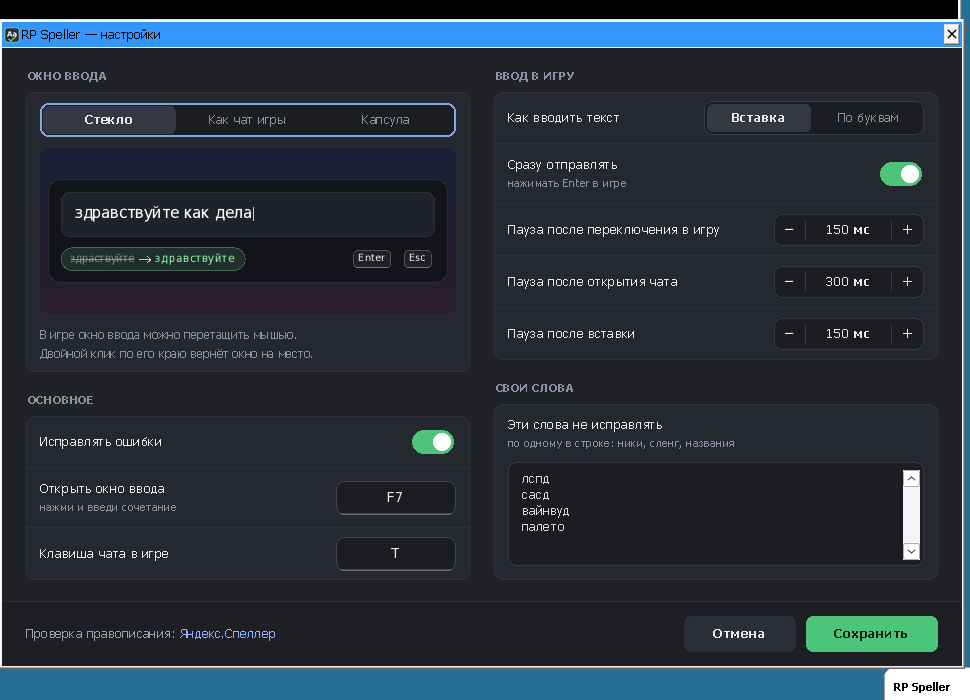
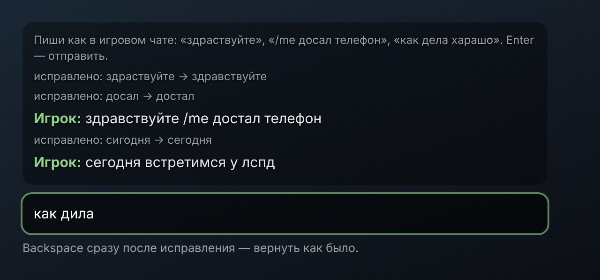

<div align="center">



**Темы «Кадр» для kinoarc, kinohub и форума LS Project, тема для роутера на OpenWrt и исправление опечаток для RP-чата.**

[Расширения](#расширения-для-браузера) · [Роутер](#роутер-openwrt) · [RP-чат](#rp-чат-gta-v--fivem) · [Скачать](#скачать) · [Структура](#структура)

</div>

## Проекты

| Проект | Где работает | Версия | Скачать |
|---|---|---|---|
| [**Кадр для kinoarc**](extensions/kadr-kinoarc/) — родные темы сайта и свой аватар | kinoarc.net, браузер | 1.3.1 | [zip](releases/kadr-themes-kinoarc-v1.3.1.zip) |
| [**Кадр для kinohub**](extensions/kadr-kinohub/) — темы, новый дизайн, закладки, тайминги у плеера | on.kinohub.vip, браузер | 1.3.1 | [zip](releases/kadr-themes-kinohub-v1.3.1.zip) |
| [**Kadr для форума LS Project**](extensions/kadr-lsforum/) — новый облик форума, темы, Monet, стили | forum.ls-project.com, браузер | 1.4.1 | [zip](releases/kadr-themes-lsforum-v1.4.1.zip) |
| [**Кадр для LuCI**](openwrt/luci-theme-kadr/) — тема для веб-интерфейса роутера и podkop | OpenWrt 25.12 и 24.10 | 1.2.0 | [apk](releases/luci-theme-kadr-1.2.0-r1.apk) · [ipk](releases/luci-theme-kadr_1.2.0-r1_all.ipk) |
| [**RP Speller**](rp-chat/rp-speller/) — исправляет опечатки в игровом чате | Windows, GTA V / FiveM | 0.3.0 | [zip](releases/RPSpeller-0.3.0.zip) |
| [**LS Autocorrect**](rp-chat/ls-autocorrect/) — автоисправление прямо в чате сервера | NUI чата сервера | — | [js](rp-chat/ls-autocorrect/ls-autocorrect.js) |

## Расширения для браузера

Все три «Кадра» меняют только внешний вид у тебя в браузере: на сайт ничего не отправляется, выключил — сайт такой же, как был. Работают на компьютере и на телефоне.

### Кадр для kinoarc



- Перекрашивает kinoarc.net в родные палитры сайта: «Мята», Noir, Mocha, Forest, Cobalt, Ember, Grape, Rose, Spark, Frost — или в свой цвет.
- Подменяет **твой** аватар. Чужие аватары не трогает.
- На телефоне в меню сайта появляется пункт «Тема и аватар». Он открывает шторку с настройками прямо поверх сайта.

[Подробнее](extensions/kadr-kinoarc/) · [Скачать 1.3.1](releases/kadr-themes-kinoarc-v1.3.1.zip)

<br clear="right">

### Кадр для kinohub


- Те же палитры, что у «Кадра» для kinoarc, плюс «Родная» — цвета сайта как есть.
- Новый дизайн on.kinohub.vip в стилистике kinoarc.
- **Закладки под рукой.** Одно нажатие кладёт фильм в быстрый список, сохранённое отмечено на карточках, все списки в одной панели.
- **Тайминги у плеера.** Отмеченные сцены под плеером, часы по самому плееру, серия определяется сама, предупреждение перед сценой.
- Лента актёров с фото на странице фильма.

[Подробнее](extensions/kadr-kinohub/) · [Скачать 1.3.1](releases/kadr-themes-kinohub-v1.3.1.zip)

<br clear="right">

### Kadr для форума LS Project


- Новый дизайн всего forum.ls-project.com в стилистике kinoarc. Разделы, кнопки и меню остаются на своих местах.
- 10 тем и свой цвет, каждая на тёмной и на белой схеме форума. Monet White, Dark и Black по палитре Material You.
- Стиль «Обычный», «Стекло» или Material, с тенями или без.
- Размер текста постов и иконки на выбор: родные, Solar или Remix.
- На телефоне — кнопка «Тема» в панели форума и шторка с настройками.
- Само проверяет, вышла ли новая версия.

[Подробнее](extensions/kadr-lsforum/) · [Скачать 1.4.1](releases/kadr-themes-lsforum-v1.4.1.zip) · [Тесты по живому форуму](extensions/kadr-lsforum-tests/) · [Промо](docs/promo/kadr-lsforum/)

<br clear="right">


### Как поставить расширение

1. Скачай архив из [`releases`](releases/) и распакуй его в постоянную папку.
2. **Chrome, Edge, Яндекс на компьютере:** `chrome://extensions` → «Режим разработчика» → «Загрузить распакованное» → папка с `manifest.json`.
3. **Телефон на Android:** браузер, который умеет ставить расширения Chrome, — тот же путь.
4. **Новую версию** распакуй в ту же папку и нажми «Обновить» на странице расширений.

## Роутер (OpenWrt)

### Кадр для LuCI


Тема для веб-интерфейса роутера в той же стилистике, что и расширения: шрифт Onest, плавающая шапка, карточки и крупные переключатели.

- 10 палитр, свой цвет и Monet White, Dark и Black. Выбираются кнопкой в шапке, у каждого устройства свой выбор.
- Стиль «Обычный», «Стекло» или Material, разделители «Скрыть», «Линия» или «Сегменты», тени по желанию.
- По желанию по экрану бегают жуки, а по кнопкам ходят жуки, нарисованные сбоку: цветные, пиксельные или силуэты цвета темы.
- podkop: секции, настройки, диагностика и дашборд в стиле темы.
- На телефоне меню и настройки открываются шторкой снизу.

Поставить на OpenWrt 25.12:

```
apk add --allow-untrusted /tmp/luci-theme-kadr-1.2.0-r1.apk
```

На OpenWrt 24.10 — «Система → Программное обеспечение → Загрузить пакет…» с файлом `.ipk` или `opkg install`.

[Подробнее и все скриншоты](openwrt/luci-theme-kadr/) · [apk для 25.12](releases/luci-theme-kadr-1.2.0-r1.apk) · [ipk для 24.10](releases/luci-theme-kadr_1.2.0-r1_all.ipk)

## RP-чат (GTA V / FiveM)

### RP Speller

| Три вида окна ввода | Настройки |
|---|---|
|  |  |

Программа для Windows, которая исправляет опечатки в том, что ты пишешь в игровой чат. Игру и сервер не трогает: работает как переводчик RP Chat Overlay — своё окно поверх игры и нажатия клавиш.

- **F7** в игре открывает окно ввода. Ошибки исправляются после пробела, **Enter** вставляет текст в игровой чат и отправляет.
- **Backspace** сразу после исправления возвращает слово, и это слово больше не исправляется. Свои слова — ники, сленг, названия — задаются в настройках.
- Три вида окна ввода: «Стекло», «Как чат игры» и «Капсула».
- Исправления от Яндекс.Спеллера, в сеть уходят отдельные слова, а не сообщения.
- Один `RPSpeller.exe` на 0,7 МБ, написан на Rust. В архиве есть самопроверка для своего компьютера.

[Подробнее](rp-chat/rp-speller/) · [Скачать 0.3.0](releases/RPSpeller-0.3.0.zip)

### LS Autocorrect



Один файл `ls-autocorrect.js` без зависимостей для интерфейса чата на сервере. Исправляет опечатки у игрока, пока он печатает, как клавиатура в телефоне: «здраствуйте» → «здравствуйте».

- Не трогает команды (`/me`, `/do` и любые другие), ID, цифры, латиницу, ссылки, имена с большой буквы и чатовый сленг.
- Backspace сразу после исправления возвращает слово и запоминает его.
- Свои слова сервера добавляются одной строкой.

[Подробнее и подключение](rp-chat/ls-autocorrect/) · [Демо-страница](rp-chat/ls-autocorrect/demo.html) (скачай папку и открой `demo.html` в браузере)

## Скачать

Все готовые файлы лежат в [`releases`](releases/).

| Файл | Что это | Размер |
|---|---|---|
| [kadr-themes-kinoarc-v1.3.1.zip](releases/kadr-themes-kinoarc-v1.3.1.zip) | Кадр для kinoarc | 44 КБ |
| [kadr-themes-kinohub-v1.3.1.zip](releases/kadr-themes-kinohub-v1.3.1.zip) | Кадр для kinohub | 153 КБ |
| [kadr-themes-lsforum-v1.4.1.zip](releases/kadr-themes-lsforum-v1.4.1.zip) | Kadr для форума LS Project | 209 КБ |
| [luci-theme-kadr-1.2.0-r1.apk](releases/luci-theme-kadr-1.2.0-r1.apk) | Кадр для LuCI, OpenWrt 25.12 | 103 КБ |
| [luci-theme-kadr_1.2.0-r1_all.ipk](releases/luci-theme-kadr_1.2.0-r1_all.ipk) | Кадр для LuCI, OpenWrt 24.10 | 102 КБ |
| [luci-theme-kadr-1.2.0.tar.gz](releases/luci-theme-kadr-1.2.0.tar.gz) | Кадр для LuCI, файлы для ручной раскладки | 101 КБ |
| [RPSpeller-0.3.0.zip](releases/RPSpeller-0.3.0.zip) | RP Speller и самопроверка | 911 КБ |

На странице файла нажми «Download raw file» (значок загрузки справа).

## Структура

```
one/
├── extensions/              расширения для браузера
│   ├── kadr-kinoarc/        Кадр для kinoarc
│   ├── kadr-kinohub/        Кадр для kinohub
│   ├── kadr-lsforum/        Kadr для форума LS Project
│   └── kadr-lsforum-tests/  прогон Kadr по живому форуму перед выпуском
├── openwrt/
│   └── luci-theme-kadr/     Кадр для LuCI
├── rp-chat/
│   ├── rp-speller/          RP Speller, программа для Windows на Rust
│   └── ls-autocorrect/      LS Autocorrect, автоисправление для чата сервера
├── releases/                готовые архивы и пакеты
└── docs/                    картинки для этого README и промо форума
```

У каждого проекта свой README: что нового, как поставить, что проверено и как собрать.

## Лицензии

- Кадр для LuCI — Apache-2.0, основан на luci-theme-bootstrap из OpenWrt ([LICENSE](openwrt/luci-theme-kadr/LICENSE)).
- Шрифт Onest — SIL Open Font License 1.1, текст лицензии лежит рядом со шрифтом.
- Наборы иконок Solar и Remix в Kadr для форума — [iconsets/LICENSES.txt](extensions/kadr-lsforum/iconsets/LICENSES.txt).
- Остальные проекты пока без отдельной лицензии.
