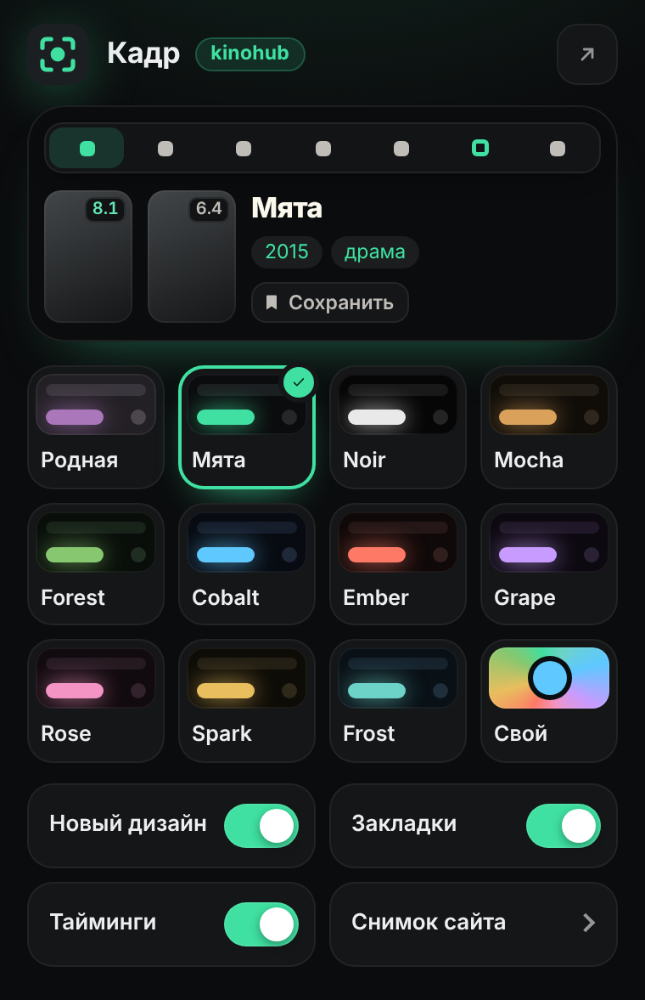
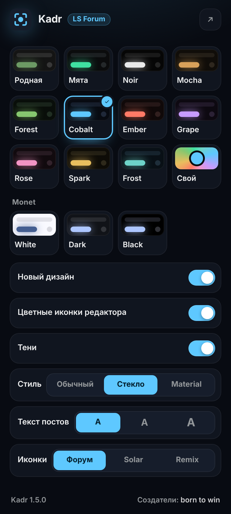
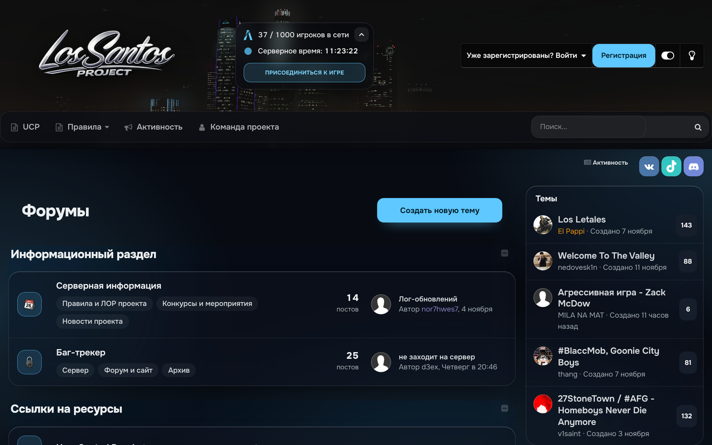
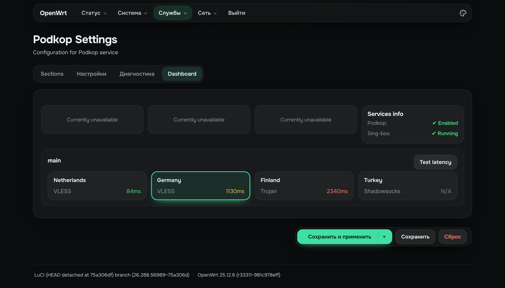

<div align="center">


**Темы «Кадр» для kinoarc, kinohub и форума LS Project и тема для роутера на OpenWrt.**

[Скачать](#скачать) · [Расширения](#расширения-для-браузера) · [Роутер](#роутер-openwrt) · [Структура](#структура) · [two →](https://github.com/splithillz/two)

</div>

## Скачать

Название проекта открывает его страницу: описание, установка, что нового. «⬇ Скачать» сразу скачивает готовый файл.

| Проект | Скачать |
|---|---|
| **[Кадр для kinoarc](extensions/kadr-kinoarc/)**<br>Расширение: родные темы kinoarc.net и свой аватар | **[⬇ Скачать](https://github.com/splithillz/one/raw/main/releases/kadr-themes-kinoarc-v1.3.1.zip)**<br><sub>zip · 1.3.1 · 44 КБ</sub> |
| **[Кадр для kinohub](extensions/kadr-kinohub/)**<br>Расширение: темы, новый дизайн, закладки и тайминги для on.kinohub.vip | **[⬇ Скачать](https://github.com/splithillz/one/raw/main/releases/kadr-themes-kinohub-v1.3.1.zip)**<br><sub>zip · 1.3.1 · 153 КБ</sub> |
| **[Kadr для форума LS Project](extensions/kadr-lsforum/)**<br>Расширение: новый облик forum.ls-project.com, темы, Monet, стили | **[⬇ Скачать](https://github.com/splithillz/one/raw/main/releases/kadr-themes-lsforum-v1.5.0.zip)**<br><sub>zip · 1.5.0 · 222 КБ</sub> |
| **[Кадр для LuCI](openwrt/luci-theme-kadr/)**<br>Тема для роутера на OpenWrt и для podkop. Ставится [одной командой](#кадр-для-luci) | **[⬇ apk](https://github.com/splithillz/one/raw/main/releases/luci-theme-kadr-1.3.0-r1.apk)** <sub>для 25.12</sub><br>**[⬇ ipk](https://github.com/splithillz/one/raw/main/releases/luci-theme-kadr_1.3.0-r1_all.ipk)** <sub>для 24.10</sub> |

Все файлы сразу — в папке [`releases`](releases/). Исправление опечаток для RP-чата — RP Speller и LS Autocorrect — переехало в репозиторий [**two**](https://github.com/splithillz/two).

## Расширения для браузера

Все три «Кадра» меняют только внешний вид у тебя в браузере: на сайт ничего не отправляется, выключил — сайт такой же, как был. Работают на компьютере и на телефоне.

### Кадр для kinoarc


- Перекрашивает kinoarc.net в родные палитры сайта: «Мята», Noir, Mocha, Forest, Cobalt, Ember, Grape, Rose, Spark, Frost — или в свой цвет.
- Подменяет **твой** аватар. Чужие аватары не трогает.
- На телефоне в меню сайта появляется пункт «Тема и аватар». Он открывает шторку с настройками прямо поверх сайта.

[](https://github.com/splithillz/one/raw/main/releases/kadr-themes-kinoarc-v1.3.1.zip)
[](extensions/kadr-kinoarc/)

<br clear="right">

### Кадр для kinohub



- Те же палитры, что у «Кадра» для kinoarc, плюс «Родная» — цвета сайта как есть.
- Новый дизайн on.kinohub.vip в стилистике kinoarc.
- **Закладки под рукой.** Одно нажатие кладёт фильм в быстрый список, сохранённое отмечено на карточках, все списки в одной панели.
- **Тайминги у плеера.** Отмеченные сцены под плеером, часы по самому плееру, серия определяется сама, предупреждение перед сценой.
- Лента актёров с фото на странице фильма.

[](https://github.com/splithillz/one/raw/main/releases/kadr-themes-kinohub-v1.3.1.zip)
[](extensions/kadr-kinohub/)

<br clear="right">

### Kadr для форума LS Project



- Новый дизайн всего forum.ls-project.com в стилистике kinoarc. Разделы, кнопки и меню остаются на своих местах.
- 10 тем и свой цвет, каждая на тёмной и на белой схеме форума. Monet White, Dark и Black по палитре Material You.
- Стиль «Обычный», «Стекло» или Material, с тенями или без.
- Размер текста постов и иконки на выбор: родные, Solar или Remix.
- У ника — значок его группы в цвете плашки: корона, гаечный ключ, щит с уровнем и другие, с подсказкой при наведении.
- На телефоне — кнопка «Тема» в панели форума и шторка с настройками.
- Само проверяет, вышла ли новая версия.

[](https://github.com/splithillz/one/raw/main/releases/kadr-themes-lsforum-v1.5.0.zip)
[](extensions/kadr-lsforum/)

Ещё: [тесты по живому форуму](extensions/kadr-lsforum-tests/) · [промо-картинки и текст](docs/promo/kadr-lsforum/)

<br clear="right">



### Как поставить расширение

1. Скачай архив кнопкой «Скачать» в разделе расширения и распакуй его в постоянную папку.
2. **Chrome, Edge, Яндекс на компьютере:** `chrome://extensions` → «Режим разработчика» → «Загрузить распакованное» → папка с `manifest.json`.
3. **Телефон на Android:** браузер, который умеет ставить расширения Chrome, — тот же путь.
4. **Новую версию** распакуй в ту же папку и нажми «Обновить» на странице расширений.

## Роутер (OpenWrt)

### Кадр для LuCI



Тема для веб-интерфейса роутера в той же стилистике, что и расширения: шрифт Onest, плавающая шапка, карточки и крупные переключатели.

- 10 палитр, свой цвет и Monet White, Dark и Black. Выбираются кнопкой в шапке, у каждого устройства свой выбор.
- Стиль «Обычный», «Стекло» или Material, разделители «Скрыть», «Линия» или «Сегменты», тени по желанию.
- По желанию по экрану бегают жуки, а по кнопкам ходят жуки, нарисованные сбоку: цветные, пиксельные или силуэты цвета темы. Отдельным тумблером добавляются Прораб и Улыбака — жуки с лицами с фотографий.
- podkop: секции, настройки, диагностика и дашборд в стиле темы.
- На телефоне меню и настройки открываются шторкой снизу.

Поставить одной командой: зайди на роутер по SSH и вставь. Работает на OpenWrt 25.12 и 24.10, эта же команда потом обновляет тему.

```
wget -q -O - https://raw.githubusercontent.com/splithillz/one/main/openwrt/luci-theme-kadr/install.sh | sh
```

Удалить — та же команда с `-s remove` в конце. Можно и вручную, пакетом из таблицы выше.

[](https://github.com/splithillz/one/raw/main/releases/luci-theme-kadr-1.3.0-r1.apk)
[](https://github.com/splithillz/one/raw/main/releases/luci-theme-kadr_1.3.0-r1_all.ipk)
[](openwrt/luci-theme-kadr/)

## Ещё: two

RP Speller и LS Autocorrect — исправление опечаток для чата GTA V / FiveM — живут в отдельном репозитории.

<a href="https://github.com/splithillz/two"></a>

[](https://github.com/splithillz/two)

## Структура

```
one/
├── extensions/              расширения для браузера
│   ├── kadr-kinoarc/        Кадр для kinoarc
│   ├── kadr-kinohub/        Кадр для kinohub
│   ├── kadr-lsforum/        Kadr для форума LS Project
│   └── kadr-lsforum-tests/  прогон Kadr по живому форуму перед выпуском
├── openwrt/
│   └── luci-theme-kadr/     Кадр для LuCI
├── releases/                готовые архивы и пакеты
└── docs/                    картинки для этого README и промо форума
```

У каждого проекта свой README: что нового, как поставить, что проверено и как собрать.

## Лицензии

- Кадр для LuCI — Apache-2.0, основан на luci-theme-bootstrap из OpenWrt ([LICENSE](openwrt/luci-theme-kadr/LICENSE)).
- Шрифт Onest — SIL Open Font License 1.1, текст лицензии лежит рядом со шрифтом.
- Иконки Solar, Remix и Tabler в Kadr для форума — [iconsets/LICENSES.txt](extensions/kadr-lsforum/iconsets/LICENSES.txt).
- Остальные проекты пока без отдельной лицензии.
