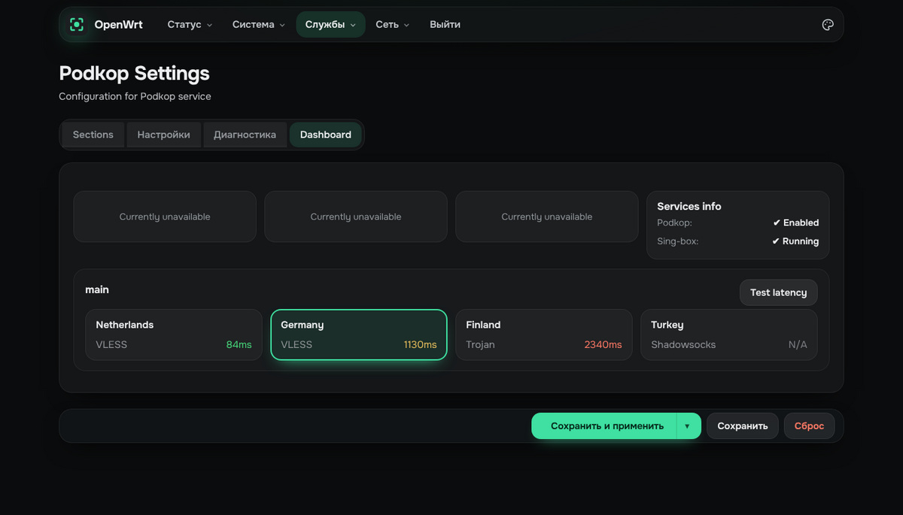
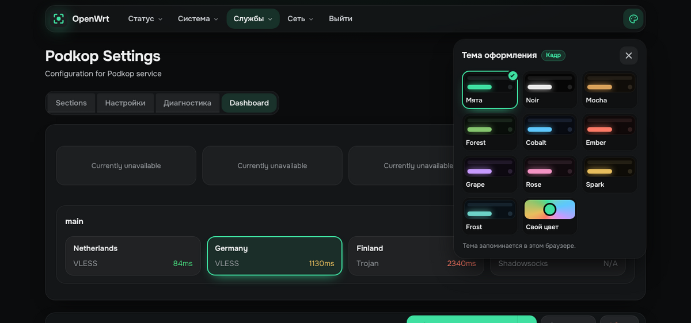
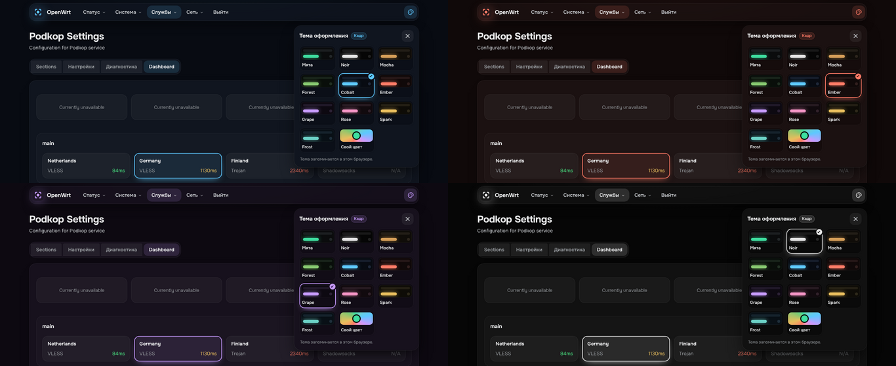
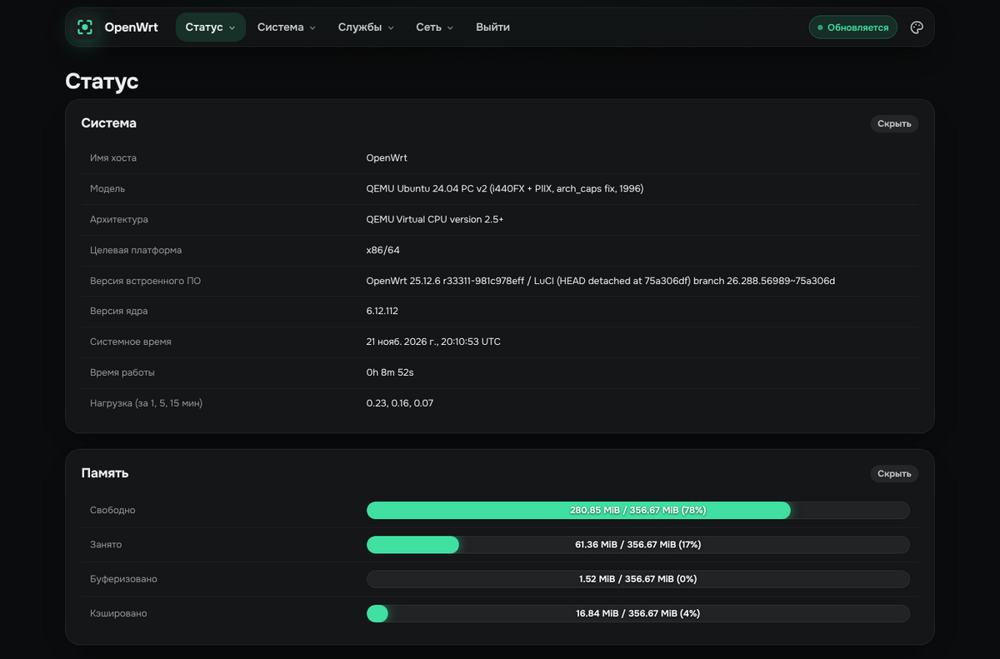
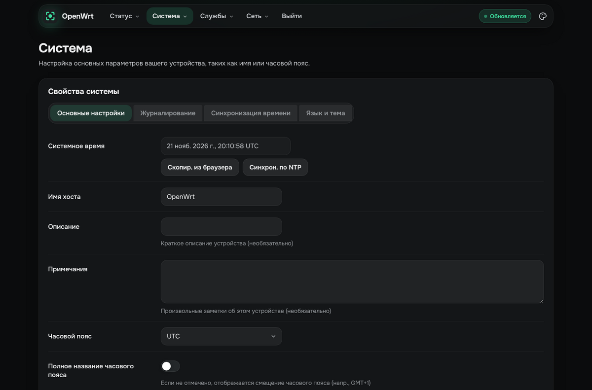
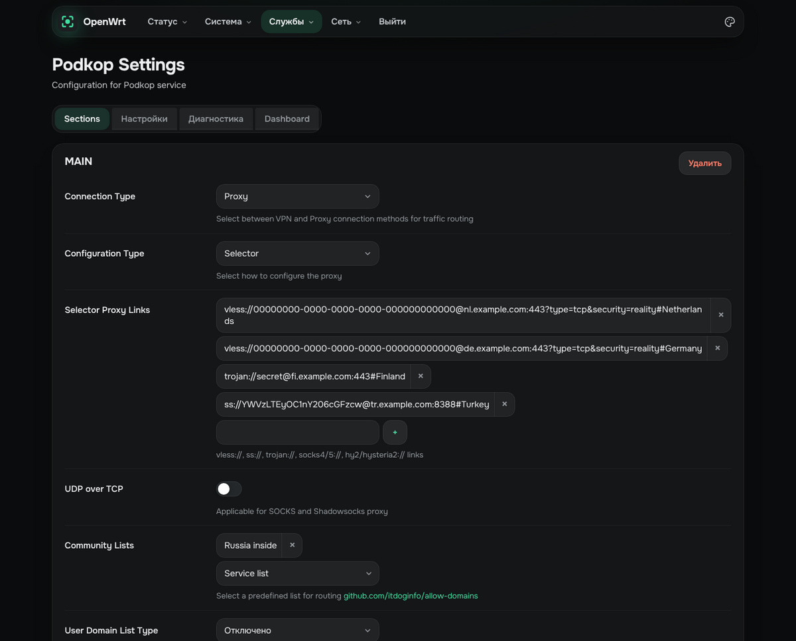
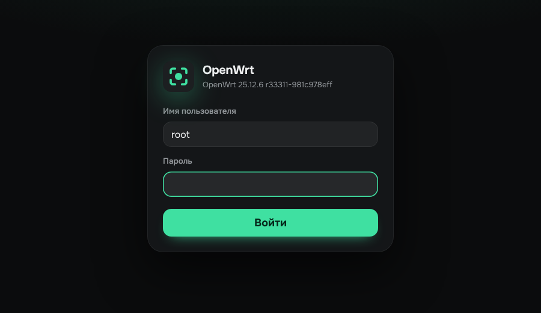
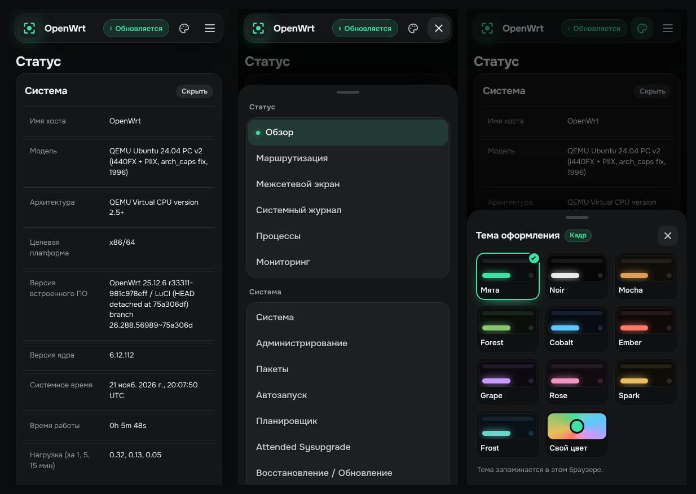

# Кадр — тема для LuCI (OpenWrt) в стиле kinoarc



Тема для веб-интерфейса роутера в той же стилистике, что «Кадр» для kinoarc и kinohub. От kinoarc взяты:
- шрифт Onest;
- почти чёрный фон со свечением акцента сверху;
- плавающая стеклянная шапка, пункты-«таблетки», карточки с тонким контуром;
- крупные переключатели и пружинящие нажатия.

Палитры те же, что в расширении: «Мята», Noir, Mocha, Forest, Cobalt, Ember, Grape, Rose, Spark, Frost и свой цвет.

- **Выбор темы прямо в шапке.** Кнопка с палитрой открывает плитки как в расширении, интерфейс перекрашивается сразу. Выбор запоминается в браузере, у каждого устройства свой.
- **Телефон.** Меню и выбор темы открываются шторкой снизу, шторку можно смахнуть. Поля и кнопки под палец, вкладки листаются.
- **podkop.** Секции, настройки, диагностика и дашборд в стиле темы. Плитки выходов, задержки и активный выход окрашиваются в палитру.
- Одна и та же тема для OpenWrt 25.12 (apk) и 24.10 (opkg). Меняется только внешний вид: разметка страниц та же, что у стандартной темы Bootstrap, поэтому другие приложения LuCI работают как обычно.





| | |
|---|---|
|  |  |
|  |  |



## Установка

Готовые пакеты лежат в папке `dist` в корне репозитория.

### OpenWrt 25.12 (apk)

1. Скопируй `luci-theme-kadr-1.0.0-r1.apk` на роутер в `/tmp`. С Windows это можно сделать через WinSCP в режиме SCP или из PowerShell:
   ```
   scp -O luci-theme-kadr-1.0.0-r1.apk root@192.168.1.1:/tmp/
   ```
2. Зайди на роутер (`ssh root@192.168.1.1`) и поставь пакет:
   ```
   apk add --allow-untrusted /tmp/luci-theme-kadr-1.0.0-r1.apk
   ```

Пакет не подписан ключом OpenWrt, поэтому нужен `--allow-untrusted`. По этой же причине в 25.12 не сработает установка через «Система → Программное обеспечение → Загрузить пакет…»: LuCI не передаёт этот флаг.

### OpenWrt 24.10 (opkg)

Через веб-интерфейс: «Система → Программное обеспечение → Загрузить пакет…», выбери `luci-theme-kadr_1.0.0-r1_all.ipk` и нажми «Установить».

Или по SSH:
```
opkg install /tmp/luci-theme-kadr_1.0.0-r1_all.ipk
```

### После установки

Тема включается сама, страницу нужно обновить с Ctrl+F5. Палитру меняй кнопкой в шапке. Сменить саму тему LuCI можно в «Система → Система → Язык и тема».

Удаление: `apk del luci-theme-kadr` или `opkg remove luci-theme-kadr`. Интерфейс вернётся на Bootstrap.

## podkop

- Версии «podkop 2.0» не существует. Последний podkop — 0.7.x из ветки main: новый интерфейс с дашбордом. Тема проверена с ним.
- podkop берёт цвета из переменных темы (тех же, что у Bootstrap), поэтому статусы и задержки сами окрашиваются. Сверху тема перерисовывает плитки дашборда и диагностики, всплывающие уведомления и модальные окна.
- После установки или обновления podkop либо темы очищай кэш браузера: этого требует сам podkop.

## Что проверено

- OpenWrt 25.12.6 и 24.10.8 (x86-64 в QEMU):
  - установка и удаление пакетом;
  - включение темы и возврат на Bootstrap.
- Страницы LuCI на русском:
  - вход, обзор, интерфейсы и окно редактирования интерфейса;
  - система, пакеты, процессы, графики, журнал, окно несохранённых изменений;
  - всё это на ширине 1366 и 390 px.
- Выбор палитры:
  - все готовые палитры и свой цвет;
  - выбор запоминается после перезагрузки страницы;
  - шторки на телефоне закрываются тапом мимо и смахиванием.
- podkop из ветки main (0.7.24), все четыре вкладки. Выходы и задержки на дашборде подставлены заглушкой, потому что sing-box в виртуалке не запускался. Проверены цвета задержек, наведение и переключение выхода кликом.

Не проверено:
- Настоящий роутер с живым sing-box.
- Страницы Wi-Fi: в виртуалке нет Wi-Fi.
- Русский перевод podkop: в стенде podkop был на английском.
- Safari на iPhone: проверял в Chromium.

## Сборка

```
python3 build.py
```

Пакеты появятся в `dist` в корне репозитория:
- `.ipk` — для opkg;
- `.apk` — классический формат apk v2, apk-tools 3 ставит его с `--allow-untrusted`;
- `.tar.gz` — те же файлы для ручной раскладки в `/`.

Через OpenWrt SDK: положи папку в `package/` или в свой feed и выполни `make package/luci-theme-kadr/compile`.

## Как устроено

- `htdocs/luci-static/kadr/base.css`, `mobile.css` — стили luci-theme-bootstrap без изменений: на них держится разметка всех страниц.
- `htdocs/luci-static/kadr/kadr.css` — оформление «Кадра»: палитра через переменные `--k-*`, компоненты, телефон, podkop.
- `htdocs/luci-static/kadr/kadr-theme.js` — палитры и формула «свой цвет» из «Кадра». Скрипт ставит выбранную тему до отрисовки страницы, чтобы не было вспышки.
- `htdocs/luci-static/resources/menu-kadr.js` — меню, шторки и выбор темы.
- `htdocs/luci-static/kadr/fonts/` — Onest (лицензия SIL OFL, текст лицензии рядом).
- `ucode/template/themes/kadr/` — шапка, подвал, страница входа.

## Лицензия

Apache-2.0. Основано на luci-theme-bootstrap из OpenWrt LuCI, авторы указаны в заголовках файлов. Шрифт Onest распространяется по SIL Open Font License 1.1.
