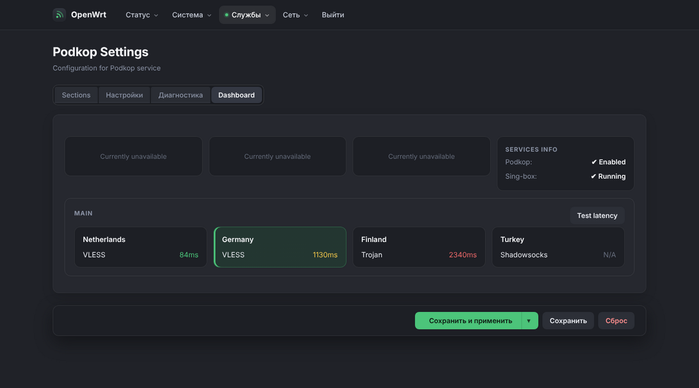
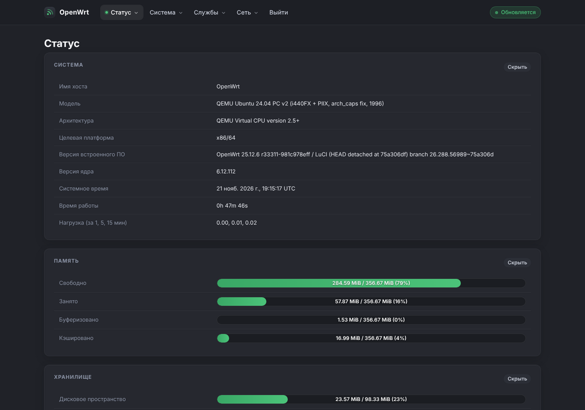
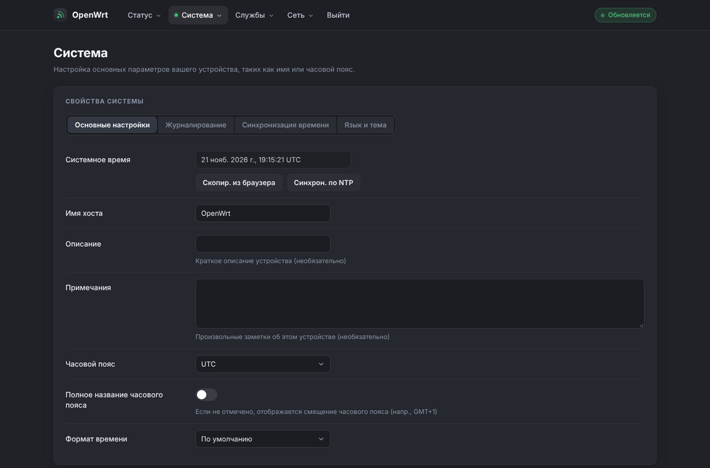
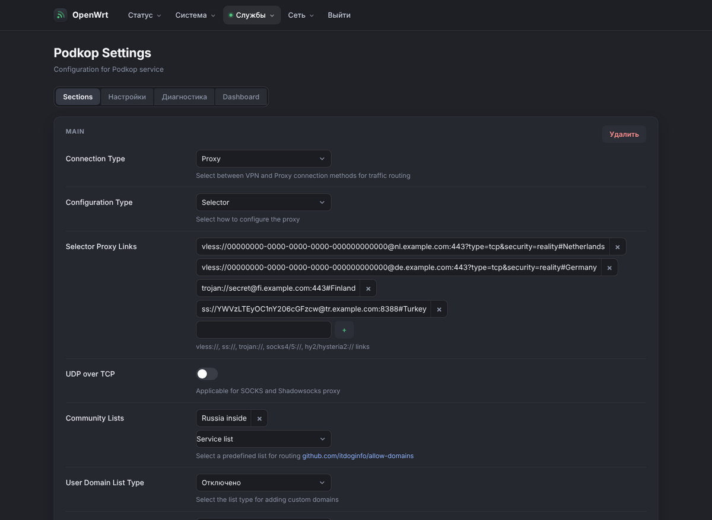
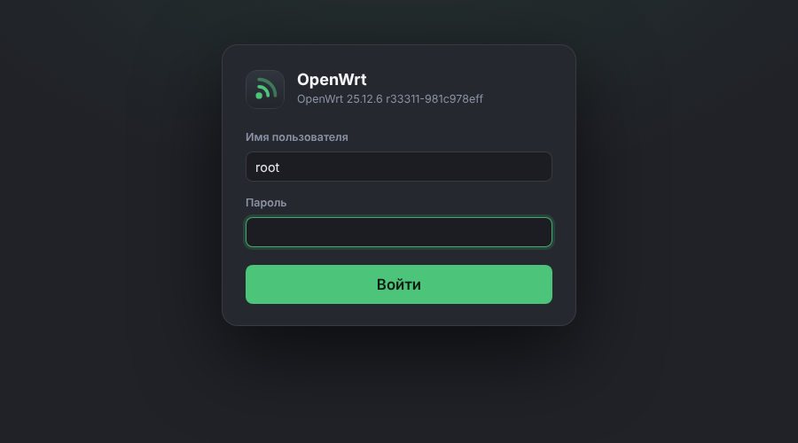
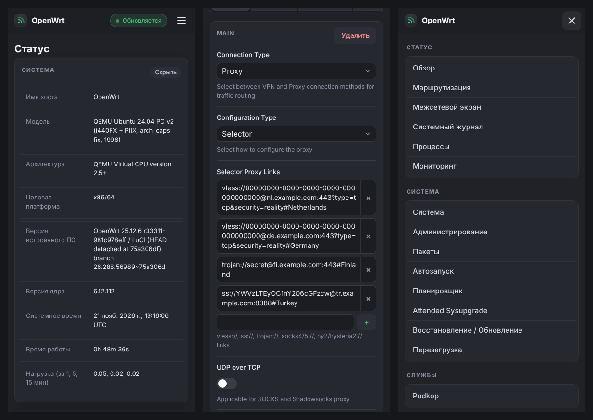

# Slate — тёмная тема для LuCI (OpenWrt) в стиле RP Speller



Тёмная тема для веб-интерфейса роутера в стиле окна настроек RP Speller:
- графитовый фон и карточки;
- переключатели вместо галочек и вкладки-сегменты;
- зелёный акцент.

Отдельно доведены страницы podkop: разделы, настройки, диагностика и дашборд (плитки выходов, задержки, активный выход).

- Одна и та же тема для OpenWrt 25.12 (apk) и 24.10 (opkg).
- На телефоне меню прячется за кнопку ☰, поля растягиваются на всю ширину, вкладки листаются пальцем.
- Панель «Сохранить и применить» прилипает к низу экрана на длинных формах.
- Меняется только внешний вид. Разметка страниц та же, что у стандартной темы Bootstrap, поэтому другие приложения LuCI работают как обычно.

| | |
|---|---|
|  |  |
|  |  |



## Установка

Готовые пакеты лежат в папке `dist` в корне репозитория.

### OpenWrt 25.12 (apk)

1. Скопируй `luci-theme-slate-1.0.0-r1.apk` на роутер в `/tmp`. С Windows это можно сделать через WinSCP в режиме SCP или из PowerShell:
   ```
   scp -O luci-theme-slate-1.0.0-r1.apk root@192.168.1.1:/tmp/
   ```
2. Зайди на роутер (`ssh root@192.168.1.1`) и поставь пакет:
   ```
   apk add --allow-untrusted /tmp/luci-theme-slate-1.0.0-r1.apk
   ```

Пакет не подписан ключом OpenWrt, поэтому нужен `--allow-untrusted`. По этой же причине в 25.12 не сработает установка через «Система → Программное обеспечение → Загрузить пакет…»: LuCI не передаёт этот флаг.

### OpenWrt 24.10 (opkg)

Через веб-интерфейс: «Система → Программное обеспечение → Загрузить пакет…», выбери `luci-theme-slate_1.0.0-r1_all.ipk` и нажми «Установить».

Или по SSH:
```
opkg install /tmp/luci-theme-slate_1.0.0-r1_all.ipk
```

### После установки

Тема включается сама, страницу нужно обновить с Ctrl+F5. Сменить тему можно в «Система → Система → Язык и тема».

Удаление: `apk del luci-theme-slate` или `opkg remove luci-theme-slate`. Интерфейс вернётся на Bootstrap.

## podkop

- Версии «podkop 2.0» не существует. Последний podkop — 0.7.x из ветки main: новый интерфейс с дашбордом, фронтенд на TypeScript. Тема проверена с ним.
- podkop берёт цвета из переменных темы (тех же, что у Bootstrap), поэтому статусы, рамки и задержки сами окрашиваются в палитру Slate. Сверху тема перерисовывает плитки дашборда и диагностики, всплывающие уведомления и модальные окна.
- После установки или обновления podkop либо темы очищай кэш браузера: этого требует сам podkop.

## Что проверено

- OpenWrt 25.12.6 и 24.10.8 (x86-64 в QEMU):
  - установка и удаление пакетом;
  - включение темы и возврат на Bootstrap;
  - на 24.10 ещё установка через «Загрузить пакет…».
- Страницы LuCI на русском:
  - вход, обзор, интерфейсы и окно редактирования интерфейса, межсетевой экран;
  - система, пакеты, процессы, графики, журнал, окно несохранённых изменений;
  - всё это на ширине 1366 и 390 px.
- podkop из ветки main (0.7.24), все четыре вкладки. Выходы и задержки на дашборде подставлены заглушкой, потому что sing-box в виртуалке не запускался. Проверены цвета задержек, наведение и переключение выхода кликом.

Не проверено:
- Настоящий роутер с живым sing-box.
- Страницы Wi-Fi: в виртуалке нет Wi-Fi.
- Русский перевод podkop: в стенде podkop был на английском. Длинные строки проверены на русском LuCI.
- Safari на iPhone: проверял в Chromium.

## Сборка

```
python3 build.py
```

Пакеты появятся в `dist` в корне репозитория:
- `.ipk` — для opkg;
- `.apk` — классический формат apk v2, apk-tools 3 ставит его с `--allow-untrusted`;
- `.tar.gz` — те же файлы для ручной раскладки в `/`.

Через OpenWrt SDK: положи папку в `package/` или в свой feed и выполни `make package/luci-theme-slate/compile`.

## Как устроено

- `htdocs/luci-static/slate/base.css`, `mobile.css` — стили luci-theme-bootstrap без изменений: на них держится разметка всех страниц.
- `htdocs/luci-static/slate/slate.css` — собственный слой: палитра, компоненты, мобильная версия, podkop.
- `ucode/template/themes/slate/` — шапка, подвал, страница входа.
- `htdocs/luci-static/resources/menu-slate.js` — меню с мобильной панелью.
- `htdocs/luci-static/resources/view/slate/sysauth.js` — окно входа.
- `root/etc/uci-defaults/30_luci-theme-slate` — регистрация темы при установке.

## Лицензия

Apache-2.0. Основано на luci-theme-bootstrap из OpenWrt LuCI, авторы указаны в заголовках файлов.
