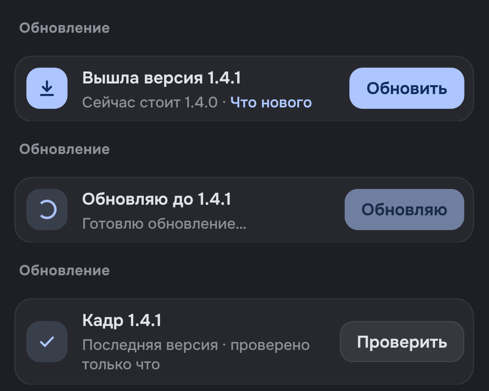
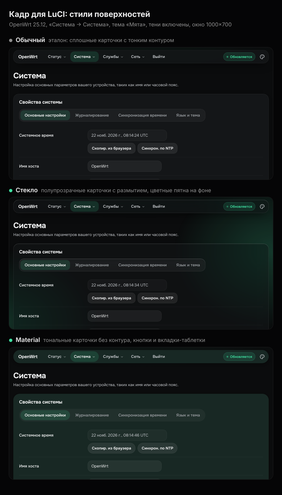
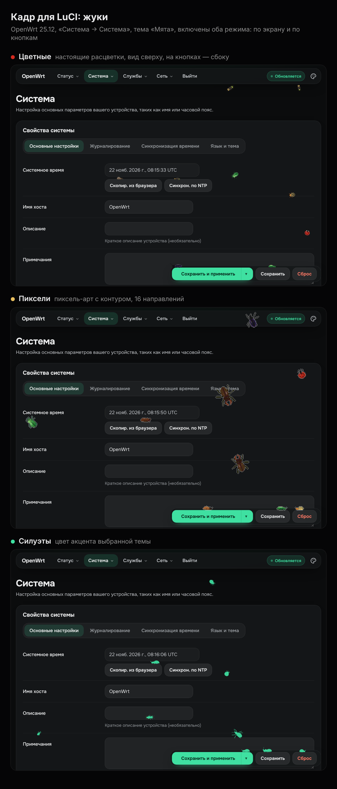
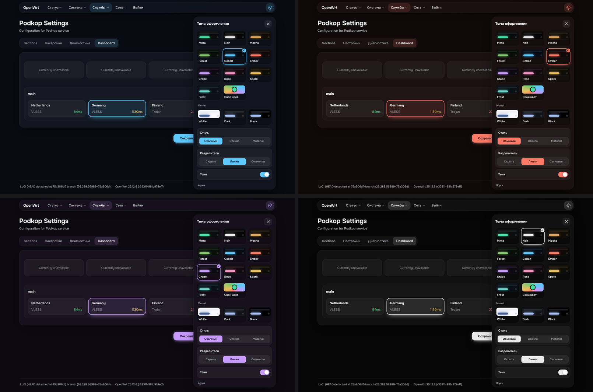
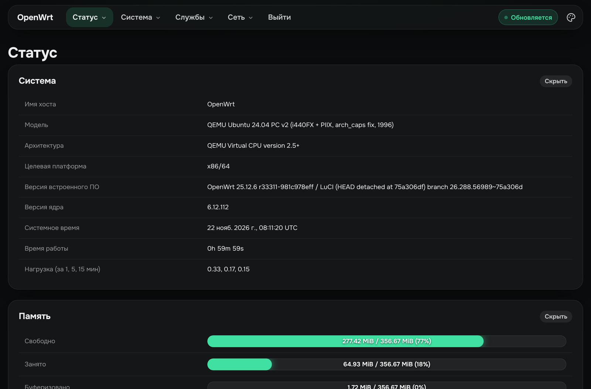
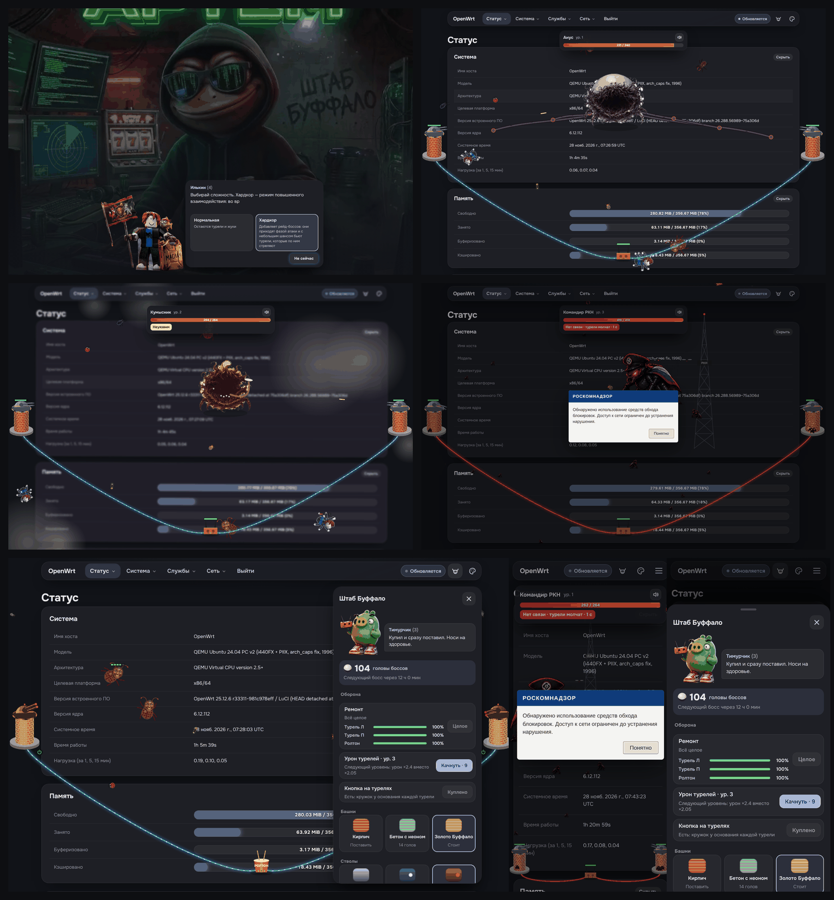
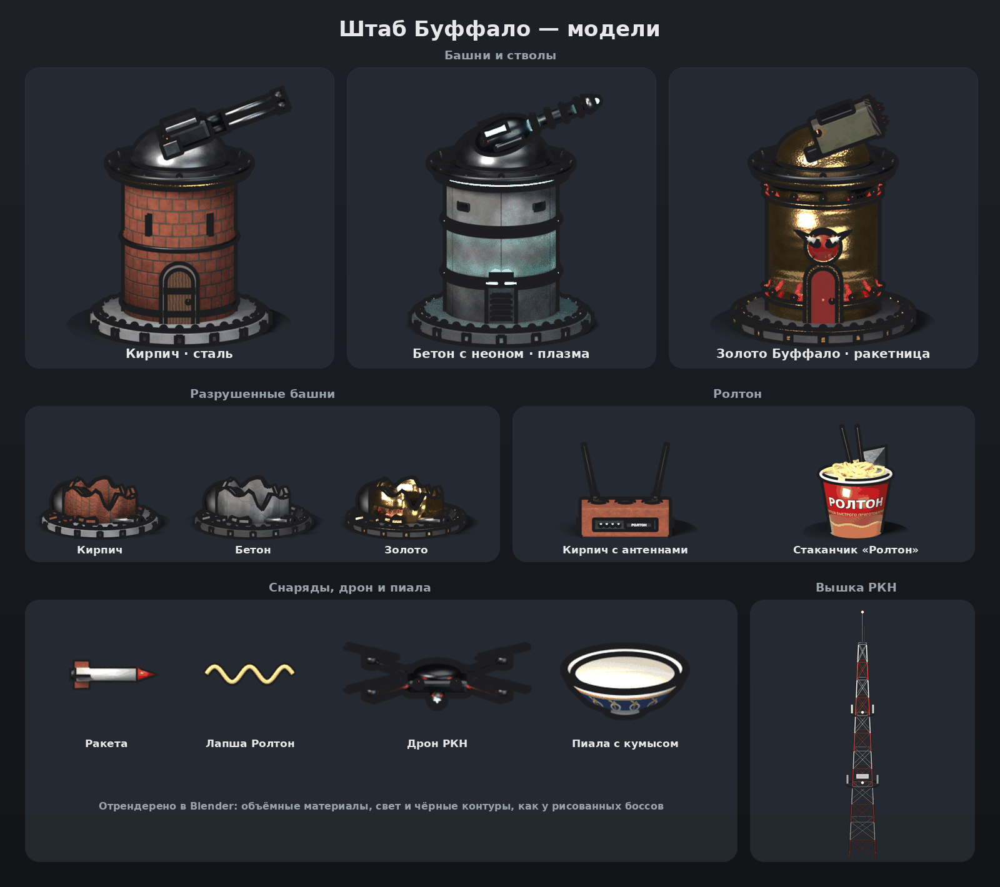

# Кадр — тема для LuCI (OpenWrt) в стиле kinoarc


Тема для веб-интерфейса роутера в той же стилистике, что «Кадр» для kinoarc и kinohub. От kinoarc взяты:
- шрифт Onest;
- почти чёрный фон со свечением акцента сверху;
- плавающая стеклянная шапка, пункты-«таблетки», карточки с тонким контуром;
- крупные переключатели и пружинящие нажатия.

Палитры те же, что в расширении: «Мята», Noir, Mocha, Forest, Cobalt, Ember, Grape, Rose, Spark, Frost, свой цвет и группа Monet:
- Monet White — светлая схема;
- Monet Dark — тёмная;
- Monet Black — на чисто чёрном фоне.

- **Выбор темы прямо в шапке.** Кнопка с палитрой открывает плитки как в расширении, интерфейс перекрашивается сразу. В обычной версии выбор запоминается в браузере, у каждого устройства свой. В полной хранится на роутере и общий для всех устройств.
- **Стиль поверхностей.** Там же переключатель «Обычный / Стекло / Material»:
  - «Стекло» — полупрозрачные карточки с размытием и цветные пятна на фоне;
  - Material — тональные карточки без контура, кнопки и вкладки-таблетки, переключатели как в Material 3.
- **Разделители.** «Скрыть / Линия / Сегменты»:
  - «Скрыть» — строки без линий;
  - «Линия» — тонкая линия между строками, как раньше;
  - «Сегменты» — каждая строка настроек и таблиц становится отдельным блоком с зазором, края группы скруглены сильнее, заголовок группы — мелкой подписью цветом акцента. Как в настройках Android 16.
- **Тени.** Тумблер «Тени» убирает все тени и свечения, остаются только тонкие контуры. Работает с любым стилем.
- **Жуки (полная версия).** По экрану бегают жуки, а по верхним краям кнопок ходят жуки, нарисованные сбоку. Их можно давить тапом или кликом. Тумблер «Метавселенная жуков» добавляет жуков с лицами с фотографий и суточную стройку турелей, которые потом стреляют по всем жукам. Подробнее ниже.
- **Рейд-боссы (полная версия, «Хардкор»).** Раз в 12 часов к роутеру-«ролтону» приходит босс: Анус, Кумысник или командир РКН. Бей его тапами и турелями, сбивай щупальца и дави жуков. Командир РКН по-настоящему выключает на роутере VPN (podkop) или интернет на время своей атаки. За победу дают головы боссов, на них в штабе Буффало качаются турели и покупаются скины. Подробнее ниже.
- **Обновление из LuCI.** Роутер сам проверяет, вышла ли новая версия. Если вышла, на кнопке с палитрой загорается точка, а в панели — плашка с кнопкой «Обновить». SSH не нужен. Подробнее ниже.
- **Телефон.** Меню и выбор темы открываются шторкой снизу, шторку можно смахнуть. Поля и кнопки под палец, вкладки листаются.
- **podkop.** Секции, настройки, диагностика и дашборд в стиле темы. Плитки выходов, задержки и активный выход окрашиваются в палитру.
- Одна и та же тема для OpenWrt 25.12 (apk) и 24.10 (opkg). Меняется только внешний вид: разметка страниц та же, что у стандартной темы Bootstrap, поэтому другие приложения LuCI работают как обычно.












| | |
|---|---|
|  |  |
|  |  |


## Две версии

| | Обычная | Полная |
|---|---|---|
| Пакет | `luci-theme-kadr` | `luci-theme-kadr-full` |
| Палитры, стили, разделители, тени, podkop, кнопка «Обновить» | да | да |
| Жуки на экране и на кнопках, давилка | — | да |
| Метавселенная жуков, стройка турелей, турели | — | да |
| Рейд-боссы, штаб Буффало, магазин прокачки (сложность «Хардкор») | — | да |
| Где хранятся настройки панели | в браузере, у каждого устройства свои | на роутере, общие для всех устройств |
| Размер пакета | около 100 КБ | около 2 МБ: 1,3 МБ — музыка боя, остальное — модели героев и боссов |

Обе версии ставятся в одни и те же папки, поэтому на роутере стоит только одна. Команда установки сама меняет одну на другую. А с обычной на полную можно перейти прямо в LuCI: в панели оформления, в блоке «Жуки», есть кнопка «Поставить», SSH не нужен.

## Установка

### Одной командой

Работает на OpenWrt 25.12 и 24.10. Зайди на роутер по SSH (`ssh root@192.168.1.1`) и вставь.

Обычная версия:

```
wget -q -O - https://raw.githubusercontent.com/splithillz/one/main/openwrt/luci-theme-kadr/install.sh | sh
```

Полная версия:

```
wget -q -O - https://raw.githubusercontent.com/splithillz/one/main/openwrt/luci-theme-kadr/install.sh | sh -s full
```

Скрипт сам:
- определит, apk у тебя или opkg;
- скачает последнюю версию темы с GitHub и сверит контрольную сумму;
- если стоит другая версия темы, уберёт её, настройки панели при этом остаются;
- поставит пакет, включит тему и почистит кеш LuCI.

Команда без слова в конце обновляет ту версию, что уже стоит. Перейти с полной на обычную — `sh -s lite`. С 1.4.0 обновлять можно и прямо из LuCI, кнопкой в панели оформления. Удалить тему:

```
wget -q -O - https://raw.githubusercontent.com/splithillz/one/main/openwrt/luci-theme-kadr/install.sh | sh -s remove
```

Если роутер не видит GitHub или `wget` ругается на SSL, поставь пакет вручную, как ниже. Что делает скрипт, видно в [`install.sh`](install.sh).

### Вручную

Готовые пакеты лежат в папке [`releases`](../../releases/) в корне репозитория.

Обычная версия:
- [`luci-theme-kadr-1.7.0-r1.apk`](https://github.com/splithillz/one/raw/main/releases/luci-theme-kadr-1.7.0-r1.apk) — для OpenWrt 25.12;
- [`luci-theme-kadr_1.7.0-r1_all.ipk`](https://github.com/splithillz/one/raw/main/releases/luci-theme-kadr_1.7.0-r1_all.ipk) — для OpenWrt 24.10.

Полная версия:
- [`luci-theme-kadr-full-1.7.0-r1.apk`](https://github.com/splithillz/one/raw/main/releases/luci-theme-kadr-full-1.7.0-r1.apk) — для OpenWrt 25.12;
- [`luci-theme-kadr-full_1.7.0-r1_all.ipk`](https://github.com/splithillz/one/raw/main/releases/luci-theme-kadr-full_1.7.0-r1_all.ipk) — для OpenWrt 24.10.

Ниже команды для обычной версии, для полной подставь имя её файла. Поверх другой версии пакет не встанет: apk и opkg напишут о конфликте и ничего не тронут. Сначала удали стоящую версию: `apk del luci-theme-kadr` или `apk del luci-theme-kadr-full`, в 24.10 — `opkg remove` с тем же именем.

#### OpenWrt 25.12 (apk)

1. Скопируй `luci-theme-kadr-1.7.0-r1.apk` на роутер в `/tmp`. С Windows это можно сделать через WinSCP в режиме SCP или из PowerShell:
   ```
   scp -O luci-theme-kadr-1.7.0-r1.apk root@192.168.1.1:/tmp/
   ```
2. Зайди на роутер (`ssh root@192.168.1.1`) и поставь пакет:
   ```
   apk add --allow-untrusted /tmp/luci-theme-kadr-1.7.0-r1.apk
   ```

Пакет не подписан ключом OpenWrt, поэтому нужен `--allow-untrusted`. По этой же причине в 25.12 не сработает установка через «Система → Программное обеспечение → Загрузить пакет…»: LuCI не передаёт этот флаг.

#### OpenWrt 24.10 (opkg)

Через веб-интерфейс: «Система → Программное обеспечение → Загрузить пакет…», выбери `luci-theme-kadr_1.7.0-r1_all.ipk` и нажми «Установить».

Или по SSH:
```
opkg install /tmp/luci-theme-kadr_1.7.0-r1_all.ipk
```

### Обновление

С 1.4.0 проще всего нажать «Обновить» в панели оформления, подробнее в разделе «Обновление из LuCI». Кнопка обновляет ту версию, что стоит: обычную до обычной, полную до полной. На 1.3.0 и раньше этой кнопки ещё нет: один раз запусти команду установки или поставь новый пакет вручную поверх старого, удалять старую версию не нужно.

До 1.6.0 жуки были в обычной теме. Кто их включал, после обновления кнопкой получит обычную версию без жуков. В панели, в блоке «Жуки», будет кнопка «Поставить»: она за несколько секунд меняет обычную версию на полную, настройки жуков сохранятся. «Прораб и Улыбака» после перехода выключены, метавселенную каждый включает сам.

Всё остальное, что выбрано в панели, сохранится. С 1.3.0 файлы темы подключаются с номером версии, поэтому после обновления хватает обычной перезагрузки страницы, Ctrl+F5 не нужен. При обновлении с 1.0.0 и 1.1.0 разделители будут «Линия», жуки выключены.

### После установки

Тема включается сама, достаточно обновить страницу. Палитру, стиль, разделители, тени и жуков меняй кнопкой в шапке. Сменить саму тему LuCI можно в «Система → Система → Язык и тема», там она называется Kadr.

Удаление: `apk del luci-theme-kadr` или `opkg remove luci-theme-kadr`, для полной версии — `luci-theme-kadr-full`. Интерфейс вернётся на Bootstrap.

## Жуки

Только в полной версии. Включаются в той же панели, в блоке «Жуки». По умолчанию выключены.

- **Бегают по экрану.** Жуки ползают в случайных направлениях, останавливаются, шевелят усами и убегают от курсора или пальца. Время от времени один уползает за край, и вместо него приползает другой. Вид сверху.
- **Ходят по кнопкам.** Несколько жуков ходят взад-вперёд по верхнему краю кнопок. Вид сбоку, ноги переставляются. Если кнопку закрыла шапка или окно, жук прячется.
- **Вид жуков.** Общий для обоих режимов:
  - «Цветные» — настоящие расцветки;
  - «Пиксели» — пиксель-арт с контуром, повороты по 16 направлениям;
  - «Силуэты» — один цвет, акцент выбранной темы.
- **Семейство.** Божья коровка, жук-олень, майский жук, колорадский жук, бронзовка, жук-носорог, долгоносик, светлячок (светится), жужелица и скарабей.
- **Давилка.** Тапни или кликни по жуку — раздавишь.
  - Мелкому (божья коровка, долгоносик, светлячок, колорадский) хватает одного касания, среднему (бронзовка, майский, жужелица, скарабей) двух, крупному (жук-олень, носорог) трёх, жителю метавселенной пяти.
  - Над подбитым жуком на пару секунд появляется полоска здоровья, а сам он удирает втрое быстрее.
  - От раздавленного остаётся пятно, оно тает за несколько секунд. Пятно от жука на кнопке едет вместе с кнопкой.
  - Клик по жуку давит только жука: кнопку или ссылку под ним он не нажимает. Клик мимо жуков работает как обычно.
  - Если открыта панель оформления, меню или окно, жуки под ними не давятся.
- **Метавселенная жуков.** Прораб, Улыбака, Нубик и Волкочервь, а ещё суточная стройка турелей. Подробнее в разделе «Метавселенная жуков».

### Сколько жуков и откуда они берутся

Переключатель «Сколько жуков»: «Мало» — половина, «Средне» — как было всегда, «Много» — вдвое больше.

| | Мало | Средне | Много |
|---|---|---|---|
| По экрану | 1 жук на ~260 тыс. px² окна, от 2 до 6 | 1 на ~130 тыс. px², от 3 до 12 | 1 на ~65 тыс. px², от 6 до 24 |
| По кнопкам, телефон / компьютер | 1 / 2 | 2 / 4 | 4 / 8 |

Например, по экрану:
- телефон 393×852 — 2, 3 или 6 жуков;
- ноутбук 1366×900 — 5, 9 или 18;
- монитор 1920×1080 — 6, 12 или 24.

Телефоном считается окно уже 700 px.

- **По экрану.**
  - При загрузке страницы все жуки появляются сразу, в случайных местах.
  - Каждому жуку даётся срок 25–70 секунд. Потом он уползает к ближайшему краю, а с случайного края заползает новый. Число держится, состав меняется.
  - Если окно изменило размер или телефон повернули, число пересчитывается: лишние уползают, недостающие приползают.
  - Жук ползёт с плавными поворотами, примерно раз в 4–5 секунд замирает на полсекунды–две и убегает от курсора или пальца ближе 100 px.
- **По кнопкам.**
  - Раз в 2,5 секунды ищутся подходящие кнопки: видны целиком, не меньше 64×26 px, ниже шапки, не в панели оформления, меню и окнах. Жуков не больше, чем таких кнопок. На странице без кнопок их нет.
  - У каждого жука своя кнопка, он ходит по её верхнему краю туда-обратно. Если кнопку закрыло, жук прячется. Если кнопка пропала больше чем на 1,5 секунды, он пересаживается на другую.
  - Жук-олень по кнопкам не ходит: слишком длинный.

Жуки рисуются на одном холсте поверх страницы, но под шапкой, панелью оформления, меню и окнами, поэтому по настройкам не ползают. Клики проходят сквозь холст, кроме кликов по самим жукам. Код жуков (`kadr-bugs.js`) загружается, только когда жуки включены. Лица жителей метавселенной зашиты в него же, отдельных файлов нет. При печати жуков не видно.

## Метавселенная жуков

Только в полной версии. Тумблер «Метавселенная жуков» в блоке «Жуки». Включается, когда работает хотя бы один режим жуков. После обновления с версий до 1.6.0 тумблер выключен. При первом включении Илькин предлагает выбрать сложность, подробнее в разделе «Рейд-боссы».


### Жители

- **Прораб** — таракан в каске, жилетке и с кирпичом.
- **Улыбака** — круглый жук с улыбкой во все зубы.
- **Нубик** — блочный жук-нуб из Roblox, нарисован кубиками.
- **Волкочервь** — как на фото: толстое кольчатое тело с мокрыми бликами и налипшей землёй, меховая шея, поднятая голова с ухмылкой. На ходу по телу бегут волны сокращений.

Как ведут себя жители:
- **Лица** вырезаны из фотографий. Лицо всегда смотрит на тебя, а тело поворачивается по ходу движения.
- **Откуда берутся.** Живут среди обычных жуков: каждый новый жук с шансом 30% оказывается жителем. При загрузке страницы один житель на экране есть всегда.
- **Сколько.** По экрану не больше четырёх сразу. По кнопкам ходит один и только по кнопкам пошире. На «Мало» лимит 2 и 1, на «Много» 8 и 2.
- **Включение и выключение.** Включил тумблер — жители приползают с краёв экрана, выключил — убегают.
- **Виды.** В «Пикселях» лица пиксельные, в «Силуэтах» перекрашены в цвет темы.

### Стройка турелей


- **Начало.** При первом включении метавселенной на любом устройстве. Стройка одна на роутер: телефон и компьютер видят её одинаково. Под тумблером видно, сколько процентов готово и сколько осталось.
- **Ровно сутки.** Прогресс считается по реальным часам от начала. Закрытая вкладка или перезагрузка страницы стройку не останавливают и не ускоряют.
- **Не отменяется.** Выключение метавселенной и даже всех жуков стройку не останавливает: она будет на экране каждого устройства, пока не закончится. Перед включением панель об этом предупреждает.
- **Где.** Внизу экрана, на земле: две площадки в нижних углах, а на широком экране — в свободных полях по бокам. Если на странице есть панель кнопок «Сохранить», площадки стоят над ней.
- **Что происходит.**
  - Стадии: разметка колышками и шнуром, котлован, бетонная подушка, кирпичная башня ряд за рядом, стальная площадка, купол, стволы, покраска.
  - Башенный кран: тележка едет по стреле, лебёдка поднимает с земли поддоны кирпича, балки, листы купола и стволы и опускает их на стройку.
  - Рабочие в касках наверху кладут кирпич мастерком, стучат молотком, варят горелкой с искрами, крутят ключом, красят кистью. Внизу пилят доски, копают и принимают груз.
  - Подносчики приходят с верхнего и нижнего края экрана (на телефоне — с бокового и нижнего) с досками, кирпичом и тачками и складывают всё в штабель у крана.
  - Табличка «МУЖИКИ (ЖУКИ) РАБОТАЮТ!» показывает процент и время до конца.
- **Звуки.** Приглушённые, звучат по тому, что сейчас происходит: молоток, мастерок, пила, горелка, трещотка ключа, мотор лебёдки и тележки, удар груза. Левая площадка звучит слева, правая справа. Браузер включает звук только после первого клика или касания на странице. Тумблер «Звуки стройки» появляется в панели только на время стройки, после неё звуков нет совсем.
- **Окончание.** Рабочие уходят, кран исчезает, турели готовы.

### Турели

- Работают, только пока включена метавселенная. Выключил тумблер — турели исчезают, включил — снова на месте. Стройка при этом заново не начинается.
- Каждая турель поворачивает стволы к ближайшему существу на своей половине экрана и стреляет с упреждением раз в 3–6 секунд. Цель держит, пока не добьёт.
- Стреляют по всем: по жукам на экране, по жукам на кнопках и по жителям метавселенной. Обычный жук погибает от одного попадания, жителю нужно четыре. Над подбитым жителем видна полоска здоровья.
- Сбитый жук кувыркается и исчезает, жук на кнопке падает с неё. Вместо них приползают новые.

Код стройки, турелей и звуков (`kadr-meta.js`) загружается, только когда он нужен.

## Рейд-боссы

Только в полной версии, на сложности «Хардкор».



### Сложность

При первом включении метавселенной Илькин (4) встречает тебя в штабе Буффало и предлагает выбрать:
- **Нормальная** — турели и жуки, как раньше.
- **Хардкор** — плюс рейд-боссы. Это режим повышенного взаимодействия: во время боёв будут временные неудобства — муть на экране, окна-предупреждения, настоящие отключения VPN или интернета. Для полного погружения рекомендуем его.

Поменять можно в панели оформления, строка «Сложность». На «Хардкоре» в шапке появляется кнопка штаба Буффало. Кто обновился с уже включённой метавселенной, того Илькин встретит один раз, при первом открытии LuCI после обновления. «Не сейчас» больше не спрашивается, сложность можно выбрать в той же строке.

### Сопротивление

| | Кто | Что делает |
|---|---|---|
| (4) | Илькин, карась-маслач | встречает в штабе, предлагает сложность, ловит кликеры |
| (3) | Тимурчик-жукомурчик | живёт в штабе: подсказывает по предметам, а у командира РКН объясняет отключения связи |
| (2) | Волк | рассказывает про Ануса и Кумысника перед первым боем с ними |
| (1) | Лис | поднимает тревогу и объявляет итог боя |
| | Артём, хакер | редко дарит после победы «Колядки» или VPN-щит и держит в штабе чёрный рынок, подробнее в разделе «Баффы Артёма» |

У каждого героя модель с его фото. На каждой реплике меняется поза: наклон головы и корпуса, рот, глаза, брови, у Лиса — выражение лица. Длинные реплики делятся на окна по 150 символов.

### Боссы

Кто придёт, решает случай.

- **Анус.** Стреляет щупальцами изо рта по турелям и ролтону: щупальце надо сбить тапом, пока не долетело. Кровь белая. Фаза атаки — шторм щупалец.
- **Кумысник.** Подвид Ануса: другой окрас, кремовые щупальца, пиала с кумысом, бегает быстрее. Фаза атаки: пьёт кумыс, экран мутит, три секунды неуязвим и носится, тараня башни. После этого хватает трёх попаданий, и фаза кончается.
- **Командир РКН.** Жук в фуражке с армией жуков, щитом «Суверенный интернет», дронами и башней РКН на фоне. Обычная атака — отряд жуков, их тем больше, чем выше уровень. Фаза атаки — отключение связи и рой мелких жуков, которые грызут башни. Пока поднят щит, тапы его не пробивают, бьют только турели.

### Реплики

Боссы говорят сами, в комикс-пузыре рядом с собой, зло и с матом, в адрес игрока. Системных окон про то, что делает босс, нет.

- **Что отрубил РКН.** Командир РКН говорит, что именно он отключил, по ответу роутера: стоял podkop — «VPN отключён, сука. Интернет теперь только провайдерский.»; podkop нет — «Рубильник опущен. Интернета нет вообще.»; роутер не послушался — «Роутер меня не слушается?! Похуй, турели я тебе всё равно заглушил». Это на первой волне боя, дальше он бросает короткую фразу или молчит.
- **Когда говорят.** Выход на позицию, фаза атаки, щит, сбитая башня, «последнее издыхание», колядки и разморозка, смерть. Победив, босс пару секунд злорадствует над сломанным ролтоном и только потом уходит.
- **Насмешки.** Первая — через 14–20 секунд боя, каждая следующая пауза в 1,4 раза длиннее, не больше 5 за бой. Чем больше боёв за плечами, тем реже: к 40 боям — 2 насмешки за бой и паузы в полтора раза длиннее.
- **Без повторов.** Фразы берутся из перетасованной колоды: пока не прозвучат все, ни одна не повторится, и новая колода не начинается с последней фразы. Колоды помнятся между боями и перезагрузками. У каждого босса 14–18 насмешек, всего фраз почти двести.
- **Повторяющиеся события** — каждая волна РКН, каждый щит, каждый глоток кумыса, каждый шторм — первый раз объявляются всегда, дальше всё реже, у ветеранов ещё реже.
- Реплики не чаще раза в 5 секунд. Пузырь не залезает на плашку босса и на окна героев. Тревога и итог боя у Лиса и реплики Артёма тоже из колод.

### Бой

- **Когда.** Через 12 часов после прошлого боя. Бой начинается с первого клика по странице. Клики по шапке, панели оформления, меню и окнам не считаются. Когда босс рядом, на кнопке штаба горит точка.
- **Как бить.** Турели стреляют по боссу сами, раз в 1,5 секунды. Тап по боссу — 1 урон. Тапами же сбиваются щупальца и давятся жуки.
- **Цель** — сохранить турели и не пустить босса к ролтону. Ролтон — это роутер: он стоит внизу посередине, на одной земле с турелями, и от него к турелям по земле идут провода.
- **Без турелей тяжело.** Когда обе турели молчат — снесены, выключены кнопкой или без связи до конца боя, — тапы бьют вполсилы, а босс звереет: атакует почти вдвое чаще, шлёт больше щупалец и жуков и бьёт на 40% сильнее. В плашке босса висит «Турели молчат». Короткие волны отключения РКН это правило не включают.
- **Победа** — босс убит. Головы в копилку и 12 часов покоя.
- **Поражение** — босс снёс обе башни и сломал ролтон. Он забирает 20–35% голов, чем выше уровень, тем больше. И тоже 12 часов покоя.
- **Ответка.** С шансом 7% босс отвечает турели, которая в него попала: шлёт в неё щупальце или пару жуков.
- **Перезагрузка страницы** бой не сбрасывает: босс возвращается с тем же здоровьем. Бой, брошенный больше чем на 10 минут, заканчивается без награды и без штрафа.
- **Один бой на роутер.** Пока бой идёт на одном устройстве, на другом босс не появится.
- **Музыка.** Во время боя играет «Сошла с ума» в исполнении MCBuffallo. Кнопка звука — в плашке босса.

### Баффы Артёма

Редкие и дорогие. Каждого можно держать только одну штуку. Достаются двумя путями: после победы с шансом 8% Артём дарит один из них, или покупаешь на чёрном рынке в штабе. В бою кнопки баффов появляются в плашке босса.

| Бафф | Против кого | Что делает | Цена |
|---|---|---|---|
| **Колядки** | любой босс | замораживает босса на 5 секунд: он не двигается и не атакует, его щупальца и жуки замирают, щит РКН и неуязвимость Кумысника слетают | 120 голов |
| **VPN-щит** | только командир РКН | 25 секунд держит связь: волны отключения не проходят, а если связь уже отключена — сразу возвращается. Потом щит сгорает, и VPN выключен до конца боя: роутер по-настоящему держит podkop остановленным (или интернет закрытым, если podkop нет), турели молчат. После боя связь возвращается сама | 200 голов — самое дорогое в штабе |

После любого баффа босс получает **neverloose**: 8 секунд урон по башням и ролтону удвоен. Над боссом горит «NEVERLOOSE ×2», в плашке — сколько осталось.

### Отключение связи

У командира РКН отключения настоящие, их делает роутер:
- **если стоит и включён podkop** — роутер останавливает podkop: интернет остаётся, но только от провайдера, без VPN;
- **если podkop нет** — роутер закрывает выход в интернет из локальной сети.

Волны идут по 6, 8, 10, 12, 14, 16, 18 и 20 секунд, каждая следующая длиннее. С podkop связь пропадает и возвращается с задержкой на время его остановки и запуска: на тестовом стенде остановка занимала 6 секунд, а запуск — 11, на живом роутере обычно быстрее. Пока связи нет, провода горят красным и турели не стреляют, а на экране висит окно «Роскомнадзор», кнопка в нём оживает через 3 секунды. Перед самым первым отключением Тимурчик (3) объясняет, что будет, и связь рубится, только когда закроешь его подсказку.

Как сделано, чтобы не остаться без интернета:
- одна волна не дольше 40 секунд, роутер возвращает связь сам по таймеру;
- блокировка без podkop — правило nftables с таймаутом, ядро снимает его само, даже если скрипт убит или тема удалена;
- время считается по аптайму роутера, поэтому перевод часов (NTP) отключение не растянет;
- конец боя и выход из «Хардкора» возвращают связь сразу; закрыл вкладку посреди волны — связь вернётся, когда волна кончится; перезагрузка роутера тоже всё возвращает;
- сам роутер в интернете остаётся, отключается только локальная сеть;
- если podkop так и остался остановленным (например, процесс убили), его поднимет следующее открытие LuCI;
- после VPN-щита связь держится отключённой до конца боя арендой: страница каждые 10 секунд продлевает её на 30 секунд. Закрыл вкладку — через 30 секунд всё вернётся само. Дольше 7 минут подряд роутер такую аренду не держит, даже если страница просит;
- странице разрешено запускать только `/usr/libexec/kadr-raid`: `cut` с одной из восьми длительностей выше, `hold`, `restore`, `heal` и `status`.

### Штаб Буффало

Кнопка с головой буйвола в шапке. Штаб открывается на весь экран, на фоне — сам штаб. Тимурчик всегда рядом и подсказывает по предметам, при первом входе — подробно, в несколько окон. Закрывается крестиком, клавишей Escape или кликом мимо панели.

| Что | Цена в головах |
|---|---|
| Урон турелей, 12 уровней, каждый +35% к базовому | 3, 4, 6, 9, 13, 19, 28, 40, 58, 85, 123, 178 |
| Ремонт башен и ролтона до целого. Сами они чинятся на 8 единиц в час | 1 за каждые 60 единиц износа |
| Кнопка на турелях: выключить или включить каждую | 6 |
| Башни: кирпич, бетон с неоном, золото Буффало | 0, 14, 30 |
| Стволы: сталь, плазма, ракетница | 0, 12, 22 |
| Снаряды: болт, лапша Ролтон, плазма-шар, ракеты | 0, 8, 14, 18 |
| Ролтон: кирпич с антеннами, стаканчик «Ролтон» | 0, 15 |
| Чёрный рынок Артёма: Колядки, VPN-щит, по одной штуке | 120, 200 |

Во время боя ремонт и урон не продаются. Купленный скин можно бесплатно поменять на другой купленный. Превью в магазине рисуются теми же моделями, что и в бою.

### Модели



Башни, стволы, руины, оба ролтона, вышка РКН, дроны, пиала Кумысника, ракета и лапша отрендерены в Blender: объёмные материалы (кирпич, бетон с неоном, кованое золото, металл), свет и чёрные контуры, как у рисованных боссов. Все модели лежат одним атласом WebP на 132 КБ и рисуются на холсте без пересчёта, поэтому кадров в секунду столько же, сколько со старой отрисовкой. Под турелями и ролтоном — полоса земли с камнями, провода лежат на ней. В виде «Силуэты» модели перекрашиваются в цвет темы, в «Пикселях» — пикселизуются как всё остальное.

### Баланс

- **Уровень боссов** — это победы минус половина поражений. От него зависят здоровье босса и награда. Здоровье: 240 + 45 за уровень, у Кумысника на 15% меньше, у командира РКН на 20% меньше: он и так глушит турели.
- **Сила атак** — урон щупалец, таранов и укусов, число щупалец и жуков, скорость босса — зависит от разрыва: уровень боссов минус удвоенный уровень урона турелей. Качнул урон — разрыв меньше, босс бьёт слабее, и какое-то время побеждаешь легко. Потом он догоняет: цена урона растёт в 1,45 раза за уровень, а награда — на одну голову за каждые 3 уровня.
- **Потолки под человека.** Щупальце бьёт не больше чем на 26, таран — на 34. За атаку не больше 3 щупалец, в шторме не больше 9, в отряде РКН не больше 6 жуков, в рое — 28.
- **Без турелей.** Когда обе турели молчат, тапы бьют вполсилы, атаки идут почти вдвое чаще, щупалец и жуков больше, щупальца летят на четверть быстрее, урон по башням на 40% выше.
- **Награда** за победу: 2 головы, плюс 1 за каждые 3 уровня, плюс 1, если башни и ролтон целы, плюс 1 за командира РКН.
- **Сколько гриндить.** Урон до конца стоит 566 голов, все скины — 133. При двух боях в сутки и одних победах это больше двух месяцев. Где-то к 25–30 уровню прокачка перестаёт успевать за боссами, начинаются поражения, а с ними уровень боссов снова падает.

Как проверено: бот с человеческим темпом — около 3,4 тапа в секунду, разброс прицела, сначала щупальца, которые вот-вот долетят, окно «Роскомнадзор» закрывает, как только кнопка оживёт, — сыграл бои с каждым боссом. Он знает точные координаты и не устаёт, так что живому игроку будет чуть тяжелее. Прокачка в строках с 0/0 по 34/11 идёт в ногу с наградами. Строки 0/0, 16/7, 24/9 и бои без турелей перемерены, когда турели переехали на землю; остальные — с прошлого замера.

| Уровень боссов / урон турелей | Анус | Кумысник | Командир РКН |
|---|---|---|---|
| 0 / 0 | победа, 78 с | победа, 76 с | победа, 71 с |
| 5 / 2 | победа, 116 с | победа, 108 с | победа, 109 с |
| 10 / 5 | победа, 130 с | победа, 122 с | победа, 130 с |
| 16 / 7 | победа, 155 с | победа, 148 с | победа, 149 с |
| 24 / 9 | победа, 207 с, одна башня побита | победа, 202 с | победа, 223 с, всё побито |
| 34 / 11 | поражение | победа на последнем издыхании, 239 с | поражение |
| 20 / 4 — прокачка отстала | поражение | победа на последнем издыхании, 268 с | поражение |
| 16 / 7 без тапов | поражение | поражение | поражение |
| 0 / 0 без турелей, только тапы | поражение, 297 с | за 5 минут у босса осталось 71%, башни побиты | за 5 минут у босса осталось 2%, башни побиты |

### Защита от автокликеров

- Засчитываются только настоящие касания и клики. События, созданные скриптом на странице, не бьют.
- Засчитывается не больше 7 тапов в секунду и не больше 5 в секунду на дистанции, с запасом в 25 тапов на рывок. Кликер с любой случайностью в интервалах и точках не выжмет больше человека.
- Ловятся кликер с ровным ритмом, клики в одну точку, пока босс бегает, и клики мышью без движения мыши. Тогда 5 секунд тапы не считаются, Илькин об этом скажет.

Это защита от кликеров, а не от подкрутки: прогресс лежит в браузере и на роутере, и хозяин роутера может поменять его руками.

## Общие настройки

Только в полной версии.

- **Что общее.** Всё, что выбрано в панели оформления: палитра, стиль, разделители, тени, жуки, метавселенная, сложность, звук. Время старта стройки. Рейды: головы, прокачка, скины, здоровье башен, кулдаун и идущий бой. Всё это лежит на роутере в файле `/etc/kadr-sync.json`.
- **Покупки.** Перед каждой покупкой штаб подтягивает с роутера свежее состояние, поэтому победа на одном устройстве не потеряется из-за покупки на другом.
- **Как доезжает.** Меняешь на одном устройстве — роутер получает изменение через полсекунды. Другие устройства подхватывают его при загрузке страницы, при возвращении на вкладку или в течение минуты.
- **Первый вход.** Новое устройство берёт настройки с роутера. Если файла ещё нет, роутер получает настройки первого устройства, которое откроет LuCI.
- **Флеш.** Файл пишется, только когда что-то меняешь, поэтому память роутера не изнашивается.
- **Если роутер не ответил**, панель работает на настройках из браузера и пишет об этом внизу.
- При удалении полной версии файл стирается.

## Обновление из LuCI

Блок «Обновление» в панели оформления (кнопка с палитрой в шапке).

- **Проверка.** Раз в 12 часов, при открытой LuCI, роутер скачивает с GitHub файл `releases/luci-theme-kadr.latest` (для полной версии — `luci-theme-kadr-full.latest`) и сравнивает версию с установленной. Проверить вручную — кнопка «Проверить».
- **Если вышла новая версия:**
  - на кнопке с палитрой загорается точка;
  - при открытии панели первой стоит плашка «Вышла версия …» со ссылкой «Что нового» и кнопкой «Обновить».
- **Кнопка «Обновить».** Роутер в фоне скачивает пакет (apk или ipk, смотря по системе) и сверяет контрольную сумму SHA-256 из того же файла. Потом ставит пакет и перезагружает страницу. Занимает несколько секунд. Если по ходу закрыть или обновить страницу, обновление всё равно доедет.
- **Если что-то пошло не так**, плашка пишет причину и предлагает «Ещё раз»:
  - роутер не видит GitHub;
  - пакет скачался битым — тогда ничего не ставится, остаётся старая версия;
  - пакетный менеджер отказался ставить.
- **Что можно странице.** Права LuCI разрешают ей запускать только `/usr/libexec/kadr-update` с командами `check`, `start`, `start full` и `status`. Адрес и пакет страница не выбирает. В полной версии ещё читать и писать файл общих настроек `/etc/kadr-sync.json` и запускать `/usr/libexec/kadr-raid` с командами из раздела «Отключение связи», больше ничего.

Если GitHub с роутера не открывается, обнови тему вручную пакетом, как в разделе «Установка».

### Переход на полную версию

В обычной версии в панели оформления, в блоке «Жуки», есть карточка «Полная версия» с кнопкой «Поставить».

- Кнопка сначала спрашивает подтверждение.
- Роутер скачивает полную версию с GitHub и сверяет контрольную сумму. Потом снимает обычную, ставит полную и перезагружает страницу. Занимает около 5 секунд.
- Битый пакет не ставится, обычная версия остаётся как была.
- Если полная версия не встала, роутер сам возвращает обычную, а карточка пишет причину.
- Всё, что выбрано в панели, сохраняется, включая настройки жуков.

## podkop

- Версии «podkop 2.0» не существует. Последний podkop — 0.7.x из ветки main: новый интерфейс с дашбордом. Тема проверена с ним.
- podkop берёт цвета из переменных темы (тех же, что у Bootstrap), поэтому статусы и задержки сами окрашиваются. Сверху тема перерисовывает плитки дашборда и диагностики, всплывающие уведомления и модальные окна.
- После установки или обновления podkop либо темы очищай кэш браузера: этого требует сам podkop.

## Что проверено

- OpenWrt 25.12.6 и 24.10.8 (x86-64 в QEMU):
  - установка, обновление поверх старой версии и удаление пакетом;
  - включение темы и возврат на Bootstrap.
- Страницы LuCI на русском:
  - вход, обзор, интерфейсы и окно редактирования интерфейса;
  - система, пакеты, процессы, графики, журнал, окно несохранённых изменений;
  - всё это на ширине 1366 и 390 px.
- Выбор палитры:
  - все готовые палитры и свой цвет;
  - выбор запоминается после перезагрузки страницы;
  - шторки на телефоне закрываются тапом мимо и смахиванием.
- podkop из ветки main (0.7.24), все четыре вкладки. Выходы и задержки на дашборде подставлены заглушкой, потому что sing-box в виртуалке не запускался. Проверены цвета задержек, наведение и переключение выхода кликом.
- Monet и стили:
  - Monet White, Dark и Black в стилях «Обычный», «Стекло» и Material, с тенями и без;
  - в светлой Monet White: вход, обзор, интерфейсы и окно интерфейса, система, журнал, графики, процессы, пакеты, меню, дашборд podkop;
  - в «Стекле» раскрытый выпадающий список не прячется под соседней карточкой.
- Разделители:
  - все три режима на страницах с настройками и с таблицами, в светлой и тёмной теме, на 1366 и 390 px;
  - окна и страница входа в «Сегментах» не ломаются.
- Жуки:
  - оба режима во всех трёх видах, в светлой и тёмной теме, на 1366 и 390 px;
  - выключение убирает холст полностью;
  - в Chromium без видеокарты держится 50–60 кадров в секунду.
- Прораб и Улыбака на 25.12 и 24.10:
  - тумблер в панели, включение и выключение на лету, после перезагрузки страницы;
  - все три вида, светлая и тёмная тема, 1366 и 390 px;
  - при выключении уходят с экрана за 2–6 секунд;
  - с ними тоже 57–67 кадров в секунду.
- Метавселенная на 25.12 и 24.10, на компьютере и телефоне:
  - Нубик и Волкочервь сверху и сбоку во всех трёх видах, в светлой и тёмной теме;
  - включение запускает стройку, статус под тумблером, включается тумблер звука;
  - выключение метавселенной, выключение всех жуков и перезагрузка страницы стройку не останавливают;
  - все стадии стройки сняты с подменой времени старта, от разметки до ухода рабочих;
  - после суток при выключенной метавселенной нет ни крана, ни турелей; включил — турели сбивают жуков, выключил — попаданий ноль;
  - звук: до первого клика звук не включается, после клика стройка звучит, при выключенном тумблере звука нет вовсе;
  - ошибок в консоли нет.
- Кнопка «Поставить» (переход на полную версию) на 25.12 и 24.10:
  - переход за 5 секунд, страница перезагрузилась уже в полной версии, настройки жуков на месте;
  - битая контрольная сумма: ничего не тронуто, карточка пишет «Пакет скачался битым»;
  - пакет с верной суммой, который пакетный менеджер не принял: роутер вернул обычную версию, тема работает, карточка пишет причину;
  - на компьютере и на телефоне кнопки подтверждения помещаются.
- Две версии на 25.12 и 24.10:
  - обычная 1.6.0 встаёт поверх 1.5.0 и убирает файлы жуков;
  - полная пакетом поверх обычной не встаёт: apk и opkg пишут о конфликте, стоящая версия цела;
  - команда установки с `full` и `lite` меняет версию, без слова в конце обновляет ту, что стоит;
  - в обычной версии нет блока «Жуки» и код жуков не грузится; если жуки были включены, в панели подсказка про полную версию;
  - в полной версии проверка обновлений идёт по `luci-theme-kadr-full.latest`.
- Общие настройки на 25.12 и 24.10, два «устройства» — компьютер и телефон со своим хранилищем браузера:
  - палитра, жуки и метавселенная с компьютера появились на телефоне при первом входе, стройка у обоих одна;
  - смена палитры на телефоне доехала до компьютера;
  - после конца стройки, выставленного прямо в файле на роутере, оба видят турели;
  - после перехода с обычной версии на полную общие настройки заработали в той же сессии LuCI.
- Давилка и турели:
  - мелкого жука давит 1 клик, среднего 2, крупного 3, жителя 5;
  - клик по жуку не доходит до страницы, клик мимо доходит;
  - под окном поверх холста жуки не давятся;
  - турели сбивают жуков на экране и на кнопках и подбивают жителей.
- Телефон: площадки стройки и турели в нижних углах, на странице настроек — над панелью «Сохранить и применить».
- Тумблер «Звуки стройки» скрыт до начала и после конца стройки, виден во время неё.
- Обновление 1.2.0 → 1.3.0 пакетом в браузере, который уже открывал тему: после обычной перезагрузки (F5) все файлы темы приходят новые, а не из кэша. На 1.2.0 браузер брал их из кэша.
- Обновление из LuCI на 25.12 (apk) и 24.10 (opkg), с телефона. GitHub подменял локальный HTTPS-сервер с тем же адресом и сертификатом, роутер ему доверял:
  - фоновая проверка, точка на кнопке, плашка, «Обновить» → новая версия стоит, страница перезагрузилась, точка пропала. От нажатия до перезагрузки 3,5–8,5 секунды;
  - битая контрольная сумма: пакет не ставится, старая версия на месте, плашка пишет причину;
  - GitHub недоступен: понятная ошибка, точка не загорается;
  - новой версии нет: «Последняя версия»;
  - обновление с 1.3.0 командой: после обычного F5 кнопка работает в той же сессии, перезаходить в LuCI не нужно.
- Жуки не рисуются поверх панели оформления. Проверка: на телефоне и на компьютере сравнивались кадры с жуками и без, внутри панели разница 0 пикселей. Для контроля со старым порядком слоёв на тех же кадрах разница 29 тыс. пикселей.
- «Сколько жуков» на 393×852, 1366×900 и 1920×1080: число жуков по экрану и по кнопкам совпадает с таблицей в разделе «Жуки». При переключении на ходу лишние уходят. На «Много» и в пиксельном виде держится 60 кадров в секунду.
- Полоски памяти и хранилища на «Обзоре» на 360, 393 и 412 px: цифры помещаются целиком. Белый текст на заливке читается во всех палитрах: контраст не ниже 4,6:1, раньше было 1,2–2,6.
- Рейд-боссы на 25.12, на компьютере (1366×900) и телефоне (Pixel 7, касания):
  - приветствие Илькина в штабе, выбор сложности, кнопка штаба и строка «Сложность»; первый вход в штаб с подсказками Тимурчика;
  - очередь окон: тост Лиса закрывается сам, подсказка Волка ждёт его, на экране всегда одно окно, бой на паузе, пока герой говорит;
  - Анус: турели бьют сами, тапом сбиваются щупальца, тапы по боссу снимают здоровье, фаза шторма, смерть, награда и кулдаун 12 часов;
  - Кумысник: пьёт кумыс, муть на экране, в неуязвимость попадания не считаются, три попадания гасят фазу, муть снимается;
  - командир РКН: подсказка Тимурчика перед отключением, связь рубится после неё, окно «Роскомнадзор» с кнопкой через 3 секунды, без связи турели не стреляют, рой давится тапом, волна кончилась — роутер сам вернул связь и турели снова стреляют, щит не пропускает тапы, вторая волна длиннее (8 секунд), конец боя возвращает связь сразу;
  - Колядки: кнопка в плашке босса, босс замирает на 5 секунд и стоит на месте, тапы по нему проходят, бафф тратится; после разморозки — neverloose, урон по башне ровно вдвое;
  - VPN-щит: против Ануса не предлагается; против РКН включается кнопкой, волна под щитом не трогает podkop; когда щит сгорает — neverloose, podkop по-настоящему останавливается и остаётся остановленным больше 40 секунд, пока страница продлевает аренду, клиент в это время ходит в интернет через провайдера; после боя podkop поднимается сам;
  - реплики: РКН здоровается, сообщает тип блокировки, колода из 18 насмешек без повторов, новая колода не начинается с последней фразы, последние слова и злорадство над ролтоном; у новичка до 5 насмешек за бой, у ветерана с 60 боями — 2;
  - штаб на весь экран: фон — штаб без хакера и надписи, у Тимурчика оба глаза и нет «(3)», цены чёрного рынка, клик мимо панели закрывает;
  - новые модели во всех скинах, руины, сломанный ролтон, вышка РКН, дроны, пиала, на компьютере и телефоне;
  - поражение: обе башни и ролтон снесены, штраф 25% голов, кулдаун;
  - перезагрузка посреди боя: тот же босс, то же здоровье, без повторной тревоги;
  - штаб: ремонт, три уровня урона по 3, 4 и 6 голов, кнопка на турелях, все скины, Escape закрывает; выключенные кнопкой турели не стреляют, включённые снова стреляют;
  - кликеры: события из скрипта не бьют, ровный ритм 100 мс ловится с предупреждением Илькина, клики в одну точку без движения мыши ловятся, живые тапы с разбросом проходят, кликер со случайными интервалами и точками упирается в лимит;
  - клик по панели оформления бой не запускает, клик по странице запускает;
  - два «устройства»: режим, головы и кнопка штаба доехали до второго, покупка на устройстве со старыми данными легла поверх свежей победы с первого, двойной клик — одна покупка, при бое на одном устройстве второе босса не запускает;
  - ошибок в консоли нет.
- Стенд с живым клиентом: роутер 25.12 с настоящим WAN, за ним в локалке клиент, весь его трафик в интернет идёт через роутер и его firewall. Бой с командиром РКН через LuCI:
  - без podkop: клиент терял интернет через 1,8 секунды после начала волны и получал его обратно через 7,6 и 8,8 секунды при волнах 6 и 8 секунд; третья волна, 10 секунд, тоже резала; блок стоял на WAN-интерфейсе; сам роутер всё это время был в интернете;
  - конец боя посреди волны вернул связь через 1,3 секунды, а вкладка, закрытая посреди волны, — через 6,9 секунды, по таймеру;
  - с настоящим podkop 0.7.24 и sing-box 1.13: во время волны sing-box, таблица PodkopTable и правило маршрутизации исчезают, клиент остаётся в интернете уже без VPN; после волны и после конца боя podkop поднимается сам; остатки прошлого боя без podkop следующей волне не мешают.
- Скрипт отключения связи на роутере:
  - без podkop: правило nftables с таймаутом стоит, снимается ядром по времени; на исходящем трафике самого роутера то же правило режет пакеты и отпускает их после таймаута; `restore` снимает сразу; одновременные `cut` и `restore` двадцать раз подряд не оставили блокировку; мусорное время из файла не даёт вечного отключения;
  - с podkop (на подменённом init-скрипте с задержками): stop и start в нужные моменты, `restore` посреди медленного stop, продление волны — один stop и один start, убитый процесс подхватывает `heal`, второй процесс не плодится.

Не проверено:
- Настоящий роутер с живым sing-box.
- Страницы Wi-Fi: в виртуалке нет Wi-Fi.
- Русский перевод podkop: в стенде podkop был на английском.
- Safari на iPhone и Firefox: проверял в Chromium.
- Физический роутер: всё гонялось в QEMU. Отключения проверены на стенде с WAN, клиентом в локалке и настоящим podkop, но в песочнице у podkop не работал DNS, поэтому его запуск шёл дольше обычного.
- Баланс на живых людях: бот играет по-человечески, но не устаёт и знает точные координаты. Насколько интересно гриндить неделями, покажут только настоящие бои.

## Что нового

### 1.7.0

- Модели в стиле рисованных боссов: башни, стволы, руины, ролтоны, вышка РКН, дроны, пиала и снаряды отрендерены в Blender, турели и ролтон стоят на земле внизу экрана, провода лежат по земле.
- Боссы говорят в пузырях — зло и с матом. Командир РКН сам сообщает, что отрубил. Насмешки берутся из колод без повторов и затихают с опытом.
- Баффы Артёма: «Колядки» замораживают любого босса, VPN-щит держит связь против РКН, но потом выключает VPN до конца боя. После любого баффа у босса neverloose — урон ×2. Редкие, дорогие, по одной штуке.
- Без турелей бой тяжёлый: тапы вполсилы, босс атакует чаще и сильнее.
- Штаб Буффало на весь экран, на фоне — штаб.
- Рейд-боссы в полной версии. При первом включении метавселенной Илькин в штабе Буффало предлагает сложность: «Нормальная» или «Хардкор». На «Хардкоре» раз в 12 часов приходит босс: Анус, Кумысник или командир РКН.
- Командир РКН по-настоящему останавливает podkop или закрывает интернет локальной сети на время атаки. Связь возвращается сама, подробности в разделе «Отключение связи».
- Штаб Буффало: магазин за головы боссов с прокачкой урона, ремонтом, кнопкой на турелях и скинами башен, стволов, снарядов и ролтона.
- Герои сопротивления с моделями по фото и мимикой: Илькин, Тимурчик, Волк, Лис и Артём с VPN-щитом.
- Баланс выверен ботом на боях со всеми боссами: сила атак зависит от разрыва между уровнем боссов и прокачкой урона, поэтому каждый уровень урона снова даёт побеждать легко, пока боссы не догонят.
- Защита от автокликеров. Музыка в бою.
- Прогресс рейдов общий для всех устройств, как и настройки.

### 1.6.1

- В обычной версии появилась кнопка «Поставить» в блоке «Жуки»: переход на полную версию прямо из LuCI, без SSH. Если полная не встанет, роутер вернёт обычную.

### 1.6.0

- Тема разделилась на две версии. Обычная — только оформление. Полная (`luci-theme-kadr-full`) — оформление, жуки, метавселенная и общие для всех устройств настройки на роутере.
- Жуков можно давить тапом или кликом. Крупным нужно больше касаний, над подбитым видна полоска здоровья, после раздавленного остаётся пятно.
- Турели стреляют по всем: по жукам на экране и на кнопках и по жителям метавселенной. Жителю нужно четыре попадания.
- Волкочервь перерисован по фото: толстое кольчатое тело с бликами и грязью, меховая шея, поднятая голова.
- Стройка одна на роутер. На телефоне площадки стоят в нижних углах.
- Тумблер «Звуки стройки» виден только во время стройки, после неё звуков нет.
- После обновления метавселенная выключена, каждый включает её сам.

### 1.5.0

- «Прораб и Улыбака» теперь «Метавселенная жуков». К ним добавились Нубик и Волкочервь.
- Суточная стройка двух турелей: кран, рабочие с инструментами, подносчики, табличка с прогрессом, приглушённые звуки. Стройку не отменить.
- После стройки турели стреляют по обычным жукам, пока включена метавселенная.
- Тумблер «Звуки стройки».

### 1.4.0

- Обновление из LuCI: проверка новых версий, точка на кнопке с палитрой, плашка и кнопка «Обновить». Подробнее в разделе «Обновление из LuCI».
- «Сколько жуков: Мало / Средне / Много»: половина, как раньше, вдвое больше. Как считается число, расписано в разделе «Жуки».
- При включённых Прорабе и Улыбаке один мем-жук после загрузки страницы есть всегда. Раньше на телефоне примерно в трети загрузок их не было.
- Жуки больше не ползают поверх панели оформления, меню и окон: холст с жуками ниже их.
- Полоски памяти и хранилища на телефоне:
  - подпись сверху, полоска на всю ширину, цифры больше не обрезаются;
  - заливка темнее, белый текст на ней читается в любой палитре.
- На телефоне в режиме «Линия» между строками таблиц была двойная линия, теперь одна.

### 1.3.0

- Прораб и Улыбака: жуки с лицами с фотографий, включаются тумблером в блоке «Жуки».
- Файлы темы подключаются с номером версии. После обновления хватает обычной перезагрузки страницы, Ctrl+F5 больше не нужен.

### 1.2.0

- Разделители «Скрыть / Линия / Сегменты».
- Жуки: по экрану и по кнопкам, виды «Цветные», «Пиксели», «Силуэты».
- Убраны значок «Кадра» из шапки и со страницы входа и надпись «Кадр» в панели. Значок вкладки браузера — стандартный OpenWrt.
- Нижняя панель с кнопками «Сохранить и применить», «Сохранить», «Сброс» больше не тянется на всю ширину: плашка ровно по кнопкам, справа. На телефоне кнопки по-прежнему на всю ширину.
- Исправлено: на телефоне кнопки «Скопировать из браузера» и «Синхронизировать по NTP» вылезали из своей строки на соседнюю.

### 1.1.0

- Темы Monet White, Monet Dark и Monet Black.
- Переключатель стиля «Обычный / Стекло / Material» и тумблер «Тени».
- Исправлено:
  - в дашборде podkop статусы «Enabled / Running» снова зелёные, ошибки красные;
  - выбранный пункт в раскрытом выпадающем списке больше не заливается акцентом с нечитаемым текстом;
  - у неактивных вкладок пропал серый фон от стандартной темы.

## Сборка

```
python3 build.py
```

Пакеты обеих версий появятся в `releases` в корне репозитория:
- `.ipk` — для opkg;
- `.apk` — классический формат apk v2, apk-tools 3 ставит его с `--allow-untrusted`;
- `.tar.gz` — те же файлы для ручной раскладки в `/`;
- `luci-theme-kadr.latest` и `luci-theme-kadr-full.latest` — номер последней версии и контрольные суммы пакетов, по ним работают команда установки и кнопка «Обновить».

Обычная версия собирается из тех же файлов без `kadr-bugs.js`, `kadr-meta.js`, `kadr-raid.js`, папки `raid/`, скрипта `kadr-raid` и прав полной версии. Каждая версия объявляет конфликт с другой.

Перед сборкой `build.py` сверяет версию и номер сборки в `Makefile` и в шапке (`header.ut`). Если они расходятся, сборка останавливается.

Через OpenWrt SDK: положи папку в `package/` или в свой feed и выполни `make package/luci-theme-kadr/compile`. SDK соберёт один пакет `luci-theme-kadr` со всеми файлами, то есть полную версию под обычным именем. Две отдельные версии собирает только `build.py`.

## Как устроено

- `htdocs/luci-static/kadr/base.css`, `mobile.css` — стили luci-theme-bootstrap без изменений: на них держится разметка всех страниц.
- `htdocs/luci-static/kadr/kadr.css` — оформление «Кадра»:
  - палитра через переменные `--k-*`, светлая схема через `data-kadr-scheme`;
  - стили через `data-kadr-fx`, тени через `data-kadr-shadows`, разделители через `data-kadr-dividers`;
  - компоненты, телефон, podkop.
- `htdocs/luci-static/kadr/kadr-theme.js` — палитры, темы Monet и формула «свой цвет» из «Кадра». Скрипт ставит выбранную тему и настройки до отрисовки страницы, чтобы не было вспышки, и в полной версии подгружает жуков, если они включены.
- `htdocs/luci-static/kadr/kadr-bugs.js` — жуки: рисунки видов сверху и сбоку, пиксельный режим, движение, здоровье, давилка и пятна. Здесь же лица жителей метавселенной в WebP. Только в полной версии.
- `htdocs/luci-static/kadr/kadr-meta.js` — стройка турелей, турели, земля и звуки, рисование моделей из атласа по точкам привязки (основание, шарнир ствола, дуло, порты проводов). Только в полной версии.
- `htdocs/luci-static/kadr/kadr-raid.js` — рейды: диалоги героев с позами, боссы, бой, плашка босса, окно РКН, муть, музыка, защита от кликеров, штаб Буффало. Загружается только на «Хардкоре». Прогресс в браузере — под ключами `kadr-luci-raid` и `kadr-luci-fight` (идущий бой), колоды реплик — под `kadr-luci-raid-talk`. Только в полной версии.
- `htdocs/luci-static/kadr/raid/` — модели боссов и героев, фон штаба, атлас моделей `models.webp`, земля `ground.webp` и фон магазина `hq-shop.webp`, музыка боя в mp3. Грузятся по требованию.
- `htdocs/luci-static/resources/menu-kadr.js` — меню, шторки, панель настроек и обновления. В полной версии ещё синхронизация с роутером: файл `/etc/kadr-sync.json` с номером правки, настройками и временем старта стройки. Копии в браузере лежат под ключами `kadr-luci-theme`, `kadr-luci-build` и `kadr-luci-sync`.
- `htdocs/luci-static/kadr/fonts/` — Onest (лицензия SIL OFL, текст лицензии рядом).
- `ucode/template/themes/kadr/` — шапка, подвал, страница входа. В шапке файлы темы подключаются с `?v=` и номером версии, а версия темы (обычная или полная) определяется по наличию `kadr-bugs.js` и ставится в `data-kadr-edition`.
- `root/usr/libexec/kadr-update` — проверка и установка обновлений на роутере: `check`, `start` (запускает установку в фоне), `start full` (меняет обычную версию на полную, при сбое возвращает обычную) и `status`. Какая версия стоит, скрипт определяет сам.
- `root/usr/share/rpcd/acl.d/luci-theme-kadr.json` — права LuCI: только эти четыре команды.
- `root/usr/libexec/kadr-raid` — отключения связи для командира РКН: `cut N` (до 40 секунд), `hold` (аренда на 30 секунд для VPN, выключенного до конца боя, не дольше 7 минут подряд), `restore`, `heal` и `status`. Без podkop ставит правило nftables с таймаутом, с podkop останавливает его и поднимает обратно одним фоновым процессом.
- `root/usr/share/rpcd/acl.d/luci-theme-kadr-full.json` — права полной версии: читать и писать `/etc/kadr-sync.json` и запускать `kadr-raid` только с перечисленными командами.
- `install.sh` — установка одной командой, смена версии и удаление.
- `build.py` — сборка обеих версий.

## Лицензия

Apache-2.0. Основано на luci-theme-bootstrap из OpenWrt LuCI, авторы указаны в заголовках файлов. Значок вкладки — стандартный логотип OpenWrt из luci-theme-bootstrap. Шрифт Onest распространяется по SIL Open Font License 1.1.

Музыка боя (`raid/boss.mp3`) — кавер MCBuffallo на песню «Я сошла с ума». Права на песню принадлежат её правообладателям, трек не входит в Apache-2.0 и лежит здесь по просьбе владельца репозитория. Модели героев и боссов сделаны из картинок владельца репозитория.
