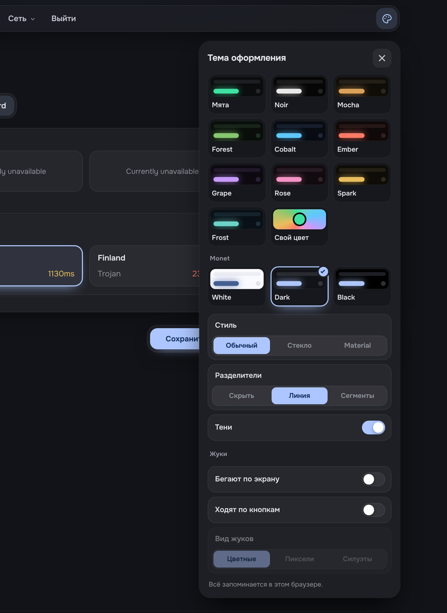
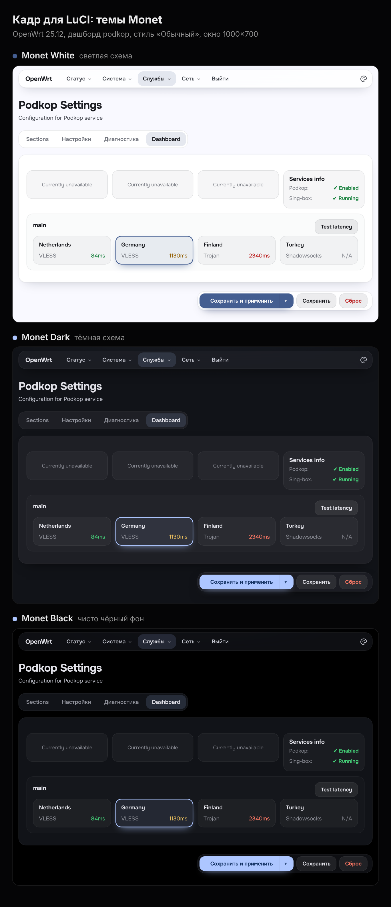
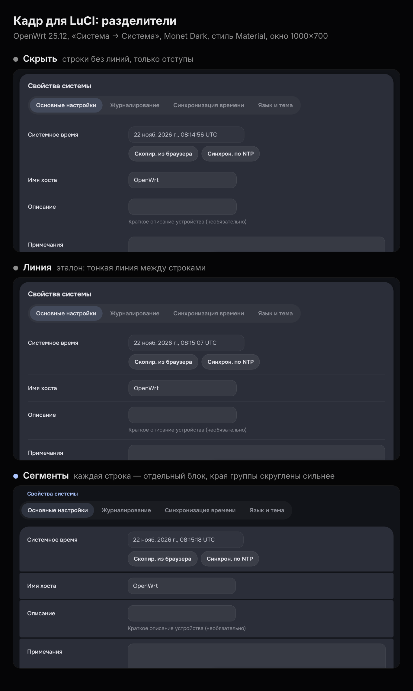
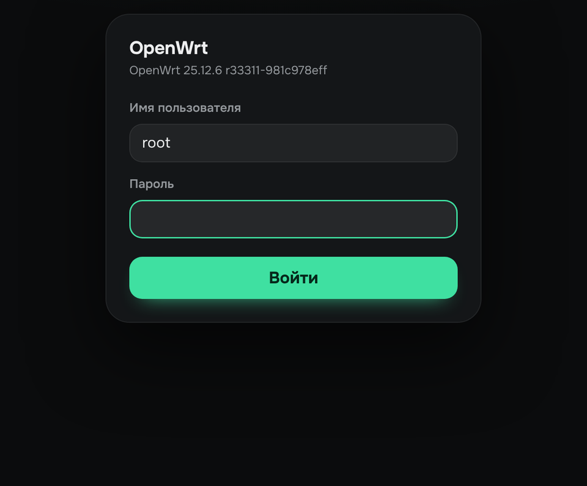

# Кадр — тема для LuCI (OpenWrt) в стиле kinoarc


Тема для веб-интерфейса роутера в той же стилистике, что «Кадр» для kinoarc и kinohub. От kinoarc взяты:
- шрифт Onest;
- почти чёрный фон со свечением акцента сверху;
- плавающая стеклянная шапка, пункты-«таблетки», карточки с тонким контуром;
- крупные переключатели и пружинящие нажатия.

Палитры те же, что в расширении: «Мята», Noir, Mocha, Forest, Cobalt, Ember, Grape, Rose, Spark, Frost, свой цвет и группа Monet:
- Monet White — светлая схема;
- Monet Dark — тёмная;
- Monet Black — на чисто чёрном фоне.

- **Выбор темы прямо в шапке.** Кнопка с палитрой открывает плитки как в расширении, интерфейс перекрашивается сразу. Выбор запоминается в браузере, у каждого устройства свой.
- **Стиль поверхностей.** Там же переключатель «Обычный / Стекло / Material»:
  - «Стекло» — полупрозрачные карточки с размытием и цветные пятна на фоне;
  - Material — тональные карточки без контура, кнопки и вкладки-таблетки, переключатели как в Material 3.
- **Разделители.** «Скрыть / Линия / Сегменты»:
  - «Скрыть» — строки без линий;
  - «Линия» — тонкая линия между строками, как раньше;
  - «Сегменты» — каждая строка настроек и таблиц становится отдельным блоком с зазором, края группы скруглены сильнее, заголовок группы — мелкой подписью цветом акцента. Как в настройках Android 16.
- **Тени.** Тумблер «Тени» убирает все тени и свечения, остаются только тонкие контуры. Работает с любым стилем.
- **Жуки.** По желанию по экрану бегают жуки, а по верхним краям кнопок ходят жуки, нарисованные сбоку. Подробнее ниже.
- **Телефон.** Меню и выбор темы открываются шторкой снизу, шторку можно смахнуть. Поля и кнопки под палец, вкладки листаются.
- **podkop.** Секции, настройки, диагностика и дашборд в стиле темы. Плитки выходов, задержки и активный выход окрашиваются в палитру.
- Одна и та же тема для OpenWrt 25.12 (apk) и 24.10 (opkg). Меняется только внешний вид: разметка страниц та же, что у стандартной темы Bootstrap, поэтому другие приложения LuCI работают как обычно.









| | |
|---|---|
|  |  |
|  |  |


## Установка

Готовые пакеты лежат в папке [`releases`](../../releases/) в корне репозитория:
- [`luci-theme-kadr-1.2.0-r1.apk`](../../releases/luci-theme-kadr-1.2.0-r1.apk) — для OpenWrt 25.12;
- [`luci-theme-kadr_1.2.0-r1_all.ipk`](../../releases/luci-theme-kadr_1.2.0-r1_all.ipk) — для OpenWrt 24.10.

### OpenWrt 25.12 (apk)

1. Скопируй `luci-theme-kadr-1.2.0-r1.apk` на роутер в `/tmp`. С Windows это можно сделать через WinSCP в режиме SCP или из PowerShell:
   ```
   scp -O luci-theme-kadr-1.2.0-r1.apk root@192.168.1.1:/tmp/
   ```
2. Зайди на роутер (`ssh root@192.168.1.1`) и поставь пакет:
   ```
   apk add --allow-untrusted /tmp/luci-theme-kadr-1.2.0-r1.apk
   ```

Пакет не подписан ключом OpenWrt, поэтому нужен `--allow-untrusted`. По этой же причине в 25.12 не сработает установка через «Система → Программное обеспечение → Загрузить пакет…»: LuCI не передаёт этот флаг.

### OpenWrt 24.10 (opkg)

Через веб-интерфейс: «Система → Программное обеспечение → Загрузить пакет…», выбери `luci-theme-kadr_1.2.0-r1_all.ipk` и нажми «Установить».

Или по SSH:
```
opkg install /tmp/luci-theme-kadr_1.2.0-r1_all.ipk
```

### Обновление с 1.0.0 и 1.1.0

Ставь новый пакет теми же командами поверх старого, удалять старую версию не нужно. Выбранная палитра, стиль и тени сохранятся. Разделители по умолчанию «Линия», жуки выключены. После обновления обнови страницу с Ctrl+F5, иначе браузер покажет старые стили из кэша.

### После установки

Тема включается сама, страницу нужно обновить с Ctrl+F5. Палитру, стиль, разделители, тени и жуков меняй кнопкой в шапке. Сменить саму тему LuCI можно в «Система → Система → Язык и тема», там она называется Kadr.

Удаление: `apk del luci-theme-kadr` или `opkg remove luci-theme-kadr`. Интерфейс вернётся на Bootstrap.

## Жуки

Включаются в той же панели, в блоке «Жуки». По умолчанию выключены.

- **Бегают по экрану.** Жуки ползают в случайных направлениях, останавливаются, шевелят усами и убегают от курсора или пальца. Время от времени один уползает за край, и вместо него приползает другой. Вид сверху.
- **Ходят по кнопкам.** Несколько жуков ходят взад-вперёд по верхнему краю кнопок. Вид сбоку, ноги переставляются. Если кнопку закрыла шапка или окно, жук прячется.
- **Вид жуков.** Общий для обоих режимов:
  - «Цветные» — настоящие расцветки;
  - «Пиксели» — пиксель-арт с контуром, повороты по 16 направлениям;
  - «Силуэты» — один цвет, акцент выбранной темы.
- **Семейство.** Божья коровка, жук-олень, майский жук, колорадский жук, бронзовка, жук-носорог, долгоносик, светлячок (светится), жужелица и скарабей.

Жуки рисуются на одном холсте поверх страницы, клики проходят сквозь него. Код жуков (`kadr-bugs.js`) загружается, только когда жуки включены. При печати их не видно.

## podkop

- Версии «podkop 2.0» не существует. Последний podkop — 0.7.x из ветки main: новый интерфейс с дашбордом. Тема проверена с ним.
- podkop берёт цвета из переменных темы (тех же, что у Bootstrap), поэтому статусы и задержки сами окрашиваются. Сверху тема перерисовывает плитки дашборда и диагностики, всплывающие уведомления и модальные окна.
- После установки или обновления podkop либо темы очищай кэш браузера: этого требует сам podkop.

## Что проверено

- OpenWrt 25.12.6 и 24.10.8 (x86-64 в QEMU):
  - установка, обновление поверх старой версии и удаление пакетом;
  - включение темы и возврат на Bootstrap.
- Страницы LuCI на русском:
  - вход, обзор, интерфейсы и окно редактирования интерфейса;
  - система, пакеты, процессы, графики, журнал, окно несохранённых изменений;
  - всё это на ширине 1366 и 390 px.
- Выбор палитры:
  - все готовые палитры и свой цвет;
  - выбор запоминается после перезагрузки страницы;
  - шторки на телефоне закрываются тапом мимо и смахиванием.
- podkop из ветки main (0.7.24), все четыре вкладки. Выходы и задержки на дашборде подставлены заглушкой, потому что sing-box в виртуалке не запускался. Проверены цвета задержек, наведение и переключение выхода кликом.
- Monet и стили:
  - Monet White, Dark и Black в стилях «Обычный», «Стекло» и Material, с тенями и без;
  - в светлой Monet White: вход, обзор, интерфейсы и окно интерфейса, система, журнал, графики, процессы, пакеты, меню, дашборд podkop;
  - в «Стекле» раскрытый выпадающий список не прячется под соседней карточкой.
- Разделители:
  - все три режима на страницах с настройками и с таблицами, в светлой и тёмной теме, на 1366 и 390 px;
  - окна и страница входа в «Сегментах» не ломаются.
- Жуки:
  - оба режима во всех трёх видах, в светлой и тёмной теме, на 1366 и 390 px;
  - выключение убирает холст полностью;
  - в Chromium без видеокарты держится 50–60 кадров в секунду.

Не проверено:
- Настоящий роутер с живым sing-box.
- Страницы Wi-Fi: в виртуалке нет Wi-Fi.
- Русский перевод podkop: в стенде podkop был на английском.
- Safari на iPhone и Firefox: проверял в Chromium.

## Что нового

### 1.2.0

- Разделители «Скрыть / Линия / Сегменты».
- Жуки: по экрану и по кнопкам, виды «Цветные», «Пиксели», «Силуэты».
- Убраны значок «Кадра» из шапки и со страницы входа и надпись «Кадр» в панели. Значок вкладки браузера — стандартный OpenWrt.
- Нижняя панель с кнопками «Сохранить и применить», «Сохранить», «Сброс» больше не тянется на всю ширину: плашка ровно по кнопкам, справа. На телефоне кнопки по-прежнему на всю ширину.
- Исправлено: на телефоне кнопки «Скопировать из браузера» и «Синхронизировать по NTP» вылезали из своей строки на соседнюю.

### 1.1.0

- Темы Monet White, Monet Dark и Monet Black.
- Переключатель стиля «Обычный / Стекло / Material» и тумблер «Тени».
- Исправлено:
  - в дашборде podkop статусы «Enabled / Running» снова зелёные, ошибки красные;
  - выбранный пункт в раскрытом выпадающем списке больше не заливается акцентом с нечитаемым текстом;
  - у неактивных вкладок пропал серый фон от стандартной темы.

## Сборка

```
python3 build.py
```

Пакеты появятся в `releases` в корне репозитория:
- `.ipk` — для opkg;
- `.apk` — классический формат apk v2, apk-tools 3 ставит его с `--allow-untrusted`;
- `.tar.gz` — те же файлы для ручной раскладки в `/`.

Через OpenWrt SDK: положи папку в `package/` или в свой feed и выполни `make package/luci-theme-kadr/compile`.

## Как устроено

- `htdocs/luci-static/kadr/base.css`, `mobile.css` — стили luci-theme-bootstrap без изменений: на них держится разметка всех страниц.
- `htdocs/luci-static/kadr/kadr.css` — оформление «Кадра»:
  - палитра через переменные `--k-*`, светлая схема через `data-kadr-scheme`;
  - стили через `data-kadr-fx`, тени через `data-kadr-shadows`, разделители через `data-kadr-dividers`;
  - компоненты, телефон, podkop.
- `htdocs/luci-static/kadr/kadr-theme.js` — палитры, темы Monet и формула «свой цвет» из «Кадра». Скрипт ставит выбранную тему и настройки до отрисовки страницы, чтобы не было вспышки, и подгружает жуков, если они включены.
- `htdocs/luci-static/kadr/kadr-bugs.js` — жуки: рисунки видов сверху и сбоку, пиксельный режим, движение.
- `htdocs/luci-static/resources/menu-kadr.js` — меню, шторки и панель настроек.
- `htdocs/luci-static/kadr/fonts/` — Onest (лицензия SIL OFL, текст лицензии рядом).
- `ucode/template/themes/kadr/` — шапка, подвал, страница входа.

## Лицензия

Apache-2.0. Основано на luci-theme-bootstrap из OpenWrt LuCI, авторы указаны в заголовках файлов. Значок вкладки — стандартный логотип OpenWrt из luci-theme-bootstrap. Шрифт Onest распространяется по SIL Open Font License 1.1.
