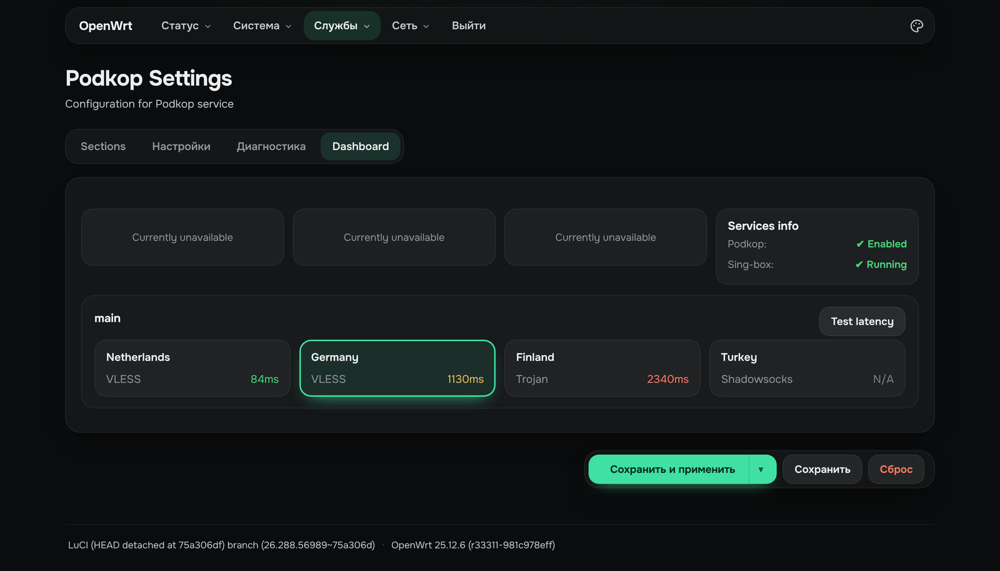
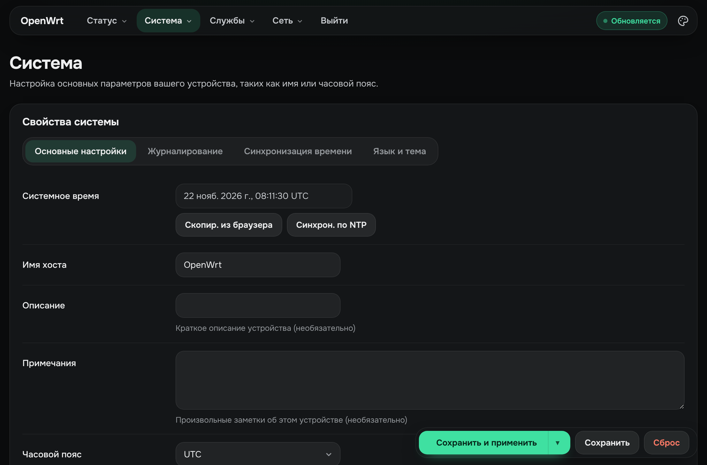
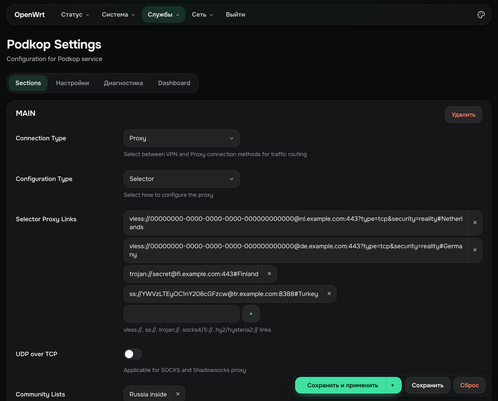
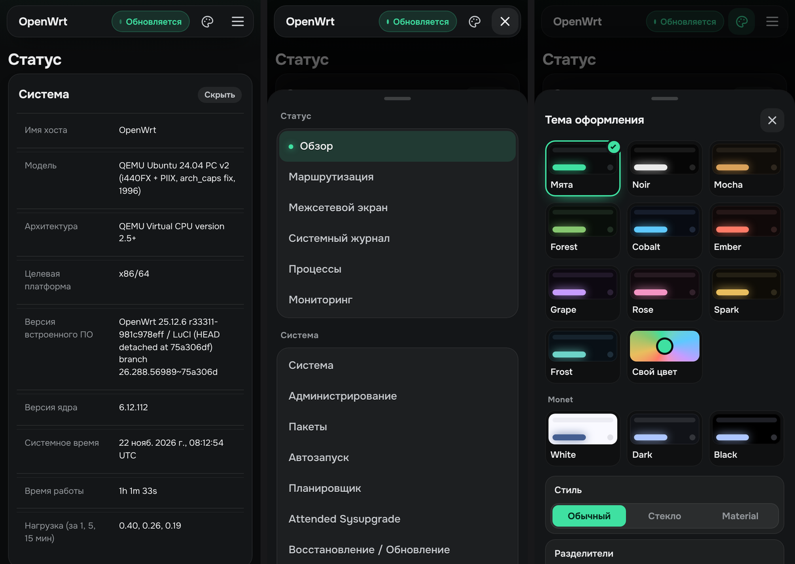
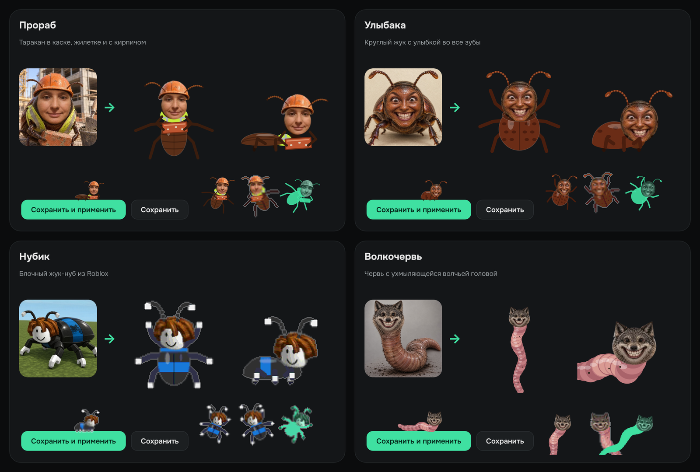
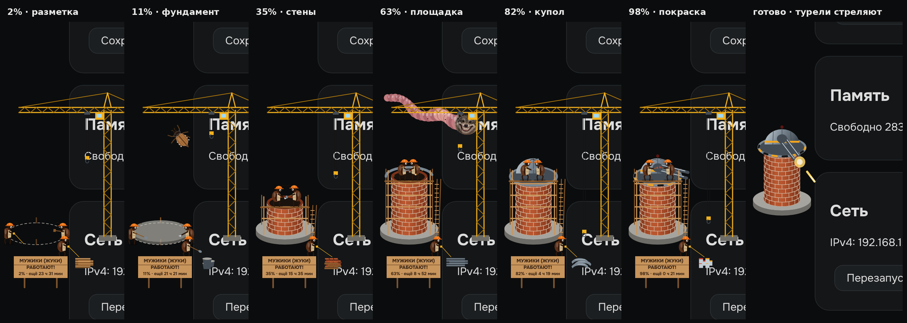

# Кадр — тема для LuCI (OpenWrt) в стиле kinoarc



Тема для веб-интерфейса роутера в той же стилистике, что «Кадр» для kinoarc и kinohub. От kinoarc взяты:
- шрифт Onest;
- почти чёрный фон со свечением акцента сверху;
- плавающая стеклянная шапка, пункты-«таблетки», карточки с тонким контуром;
- крупные переключатели и пружинящие нажатия.

Палитры те же, что в расширении: «Мята», Noir, Mocha, Forest, Cobalt, Ember, Grape, Rose, Spark, Frost, свой цвет и группа Monet:
- Monet White — светлая схема;
- Monet Dark — тёмная;
- Monet Black — на чисто чёрном фоне.

- **Выбор темы прямо в шапке.** Кнопка с палитрой открывает плитки как в расширении, интерфейс перекрашивается сразу. Выбор запоминается в браузере, у каждого устройства свой.
- **Стиль поверхностей.** Там же переключатель «Обычный / Стекло / Material»:
  - «Стекло» — полупрозрачные карточки с размытием и цветные пятна на фоне;
  - Material — тональные карточки без контура, кнопки и вкладки-таблетки, переключатели как в Material 3.
- **Разделители.** «Скрыть / Линия / Сегменты»:
  - «Скрыть» — строки без линий;
  - «Линия» — тонкая линия между строками, как раньше;
  - «Сегменты» — каждая строка настроек и таблиц становится отдельным блоком с зазором, края группы скруглены сильнее, заголовок группы — мелкой подписью цветом акцента. Как в настройках Android 16.
- **Тени.** Тумблер «Тени» убирает все тени и свечения, остаются только тонкие контуры. Работает с любым стилем.
- **Жуки.** По желанию по экрану бегают жуки, а по верхним краям кнопок ходят жуки, нарисованные сбоку. Тумблер «Метавселенная жуков» добавляет жуков с лицами с фотографий и суточную стройку турелей, которые потом стреляют по обычным жукам. Подробнее ниже.
- **Обновление из LuCI.** Роутер сам проверяет, вышла ли новая версия. Если вышла, на кнопке с палитрой загорается точка, а в панели — плашка с кнопкой «Обновить». SSH не нужен. Подробнее ниже.
- **Телефон.** Меню и выбор темы открываются шторкой снизу, шторку можно смахнуть. Поля и кнопки под палец, вкладки листаются.
- **podkop.** Секции, настройки, диагностика и дашборд в стиле темы. Плитки выходов, задержки и активный выход окрашиваются в палитру.
- Одна и та же тема для OpenWrt 25.12 (apk) и 24.10 (opkg). Меняется только внешний вид: разметка страниц та же, что у стандартной темы Bootstrap, поэтому другие приложения LuCI работают как обычно.


| | |
|---|---|
|  |  |
|  |  |



## Установка

### Одной командой

Работает на OpenWrt 25.12 и 24.10. Зайди на роутер по SSH (`ssh root@192.168.1.1`) и вставь:

```
wget -q -O - https://raw.githubusercontent.com/splithillz/one/main/openwrt/luci-theme-kadr/install.sh | sh
```

Скрипт сам:
- определит, apk у тебя или opkg;
- скачает последнюю версию темы с GitHub и сверит контрольную сумму;
- поставит пакет, включит тему и почистит кеш LuCI.

Эта же команда обновляет тему до свежей версии. С 1.4.0 обновлять можно и прямо из LuCI, кнопкой в панели оформления. Удалить тему:

```
wget -q -O - https://raw.githubusercontent.com/splithillz/one/main/openwrt/luci-theme-kadr/install.sh | sh -s remove
```

Если роутер не видит GitHub или `wget` ругается на SSL, поставь пакет вручную, как ниже. Что делает скрипт, видно в [`install.sh`](install.sh).

### Вручную

Готовые пакеты лежат в папке [`releases`](../../releases/) в корне репозитория:
- [`luci-theme-kadr-1.5.0-r1.apk`](https://github.com/splithillz/one/raw/main/releases/luci-theme-kadr-1.5.0-r1.apk) — для OpenWrt 25.12;
- [`luci-theme-kadr_1.5.0-r1_all.ipk`](https://github.com/splithillz/one/raw/main/releases/luci-theme-kadr_1.5.0-r1_all.ipk) — для OpenWrt 24.10.

#### OpenWrt 25.12 (apk)

1. Скопируй `luci-theme-kadr-1.5.0-r1.apk` на роутер в `/tmp`. С Windows это можно сделать через WinSCP в режиме SCP или из PowerShell:
   ```
   scp -O luci-theme-kadr-1.5.0-r1.apk root@192.168.1.1:/tmp/
   ```
2. Зайди на роутер (`ssh root@192.168.1.1`) и поставь пакет:
   ```
   apk add --allow-untrusted /tmp/luci-theme-kadr-1.5.0-r1.apk
   ```

Пакет не подписан ключом OpenWrt, поэтому нужен `--allow-untrusted`. По этой же причине в 25.12 не сработает установка через «Система → Программное обеспечение → Загрузить пакет…»: LuCI не передаёт этот флаг.

#### OpenWrt 24.10 (opkg)

Через веб-интерфейс: «Система → Программное обеспечение → Загрузить пакет…», выбери `luci-theme-kadr_1.5.0-r1_all.ipk` и нажми «Установить».

Или по SSH:
```
opkg install /tmp/luci-theme-kadr_1.5.0-r1_all.ipk
```

### Обновление

С 1.4.0 проще всего нажать «Обновить» в панели оформления, подробнее в разделе «Обновление из LuCI». На 1.3.0 и раньше этой кнопки ещё нет: один раз запусти команду установки или поставь новый пакет вручную поверх старого, удалять старую версию не нужно. Всё, что выбрано в панели, сохранится. Если были включены «Прораб и Улыбака», после обновления до 1.5.0 это уже «Метавселенная жуков», и сразу начнётся стройка турелей. С 1.3.0 файлы темы подключаются с номером версии, поэтому после обновления хватает обычной перезагрузки страницы, Ctrl+F5 не нужен. При обновлении с 1.0.0 и 1.1.0 разделители будут «Линия», жуки выключены.

### После установки

Тема включается сама, достаточно обновить страницу. Палитру, стиль, разделители, тени и жуков меняй кнопкой в шапке. Сменить саму тему LuCI можно в «Система → Система → Язык и тема», там она называется Kadr.

Удаление: `apk del luci-theme-kadr` или `opkg remove luci-theme-kadr`. Интерфейс вернётся на Bootstrap.

## Жуки

Включаются в той же панели, в блоке «Жуки». По умолчанию выключены.

- **Бегают по экрану.** Жуки ползают в случайных направлениях, останавливаются, шевелят усами и убегают от курсора или пальца. Время от времени один уползает за край, и вместо него приползает другой. Вид сверху.
- **Ходят по кнопкам.** Несколько жуков ходят взад-вперёд по верхнему краю кнопок. Вид сбоку, ноги переставляются. Если кнопку закрыла шапка или окно, жук прячется.
- **Вид жуков.** Общий для обоих режимов:
  - «Цветные» — настоящие расцветки;
  - «Пиксели» — пиксель-арт с контуром, повороты по 16 направлениям;
  - «Силуэты» — один цвет, акцент выбранной темы.
- **Семейство.** Божья коровка, жук-олень, майский жук, колорадский жук, бронзовка, жук-носорог, долгоносик, светлячок (светится), жужелица и скарабей.
- **Метавселенная жуков.** Прораб, Улыбака, Нубик и Волкочервь, а ещё суточная стройка турелей. Подробнее в разделе «Метавселенная жуков».

### Сколько жуков и откуда они берутся

Переключатель «Сколько жуков»: «Мало» — половина, «Средне» — как было всегда, «Много» — вдвое больше.

| | Мало | Средне | Много |
|---|---|---|---|
| По экрану | 1 жук на ~260 тыс. px² окна, от 2 до 6 | 1 на ~130 тыс. px², от 3 до 12 | 1 на ~65 тыс. px², от 6 до 24 |
| По кнопкам, телефон / компьютер | 1 / 2 | 2 / 4 | 4 / 8 |

Например, по экрану:
- телефон 393×852 — 2, 3 или 6 жуков;
- ноутбук 1366×900 — 5, 9 или 18;
- монитор 1920×1080 — 6, 12 или 24.

Телефоном считается окно уже 700 px.

- **По экрану.**
  - При загрузке страницы все жуки появляются сразу, в случайных местах.
  - Каждому жуку даётся срок 25–70 секунд. Потом он уползает к ближайшему краю, а с случайного края заползает новый. Число держится, состав меняется.
  - Если окно изменило размер или телефон повернули, число пересчитывается: лишние уползают, недостающие приползают.
  - Жук ползёт с плавными поворотами, примерно раз в 4–5 секунд замирает на полсекунды–две и убегает от курсора или пальца ближе 130 px.
- **По кнопкам.**
  - Раз в 2,5 секунды ищутся подходящие кнопки: видны целиком, не меньше 64×26 px, ниже шапки, не в панели оформления, меню и окнах. Жуков не больше, чем таких кнопок. На странице без кнопок их нет.
  - У каждого жука своя кнопка, он ходит по её верхнему краю туда-обратно. Если кнопку закрыло, жук прячется. Если кнопка пропала больше чем на 1,5 секунды, он пересаживается на другую.
  - Жук-олень по кнопкам не ходит: слишком длинный.

Жуки рисуются на одном холсте поверх страницы, но под шапкой, панелью оформления, меню и окнами, поэтому по настройкам не ползают. Клики проходят сквозь холст. Код жуков (`kadr-bugs.js`) загружается, только когда жуки включены. Лица жителей метавселенной зашиты в него же, отдельных файлов нет. При печати жуков не видно.

## Метавселенная жуков

Тумблер «Метавселенная жуков» в блоке «Жуки». Включается, когда работает хотя бы один режим жуков.



### Жители

- **Прораб** — таракан в каске, жилетке и с кирпичом.
- **Улыбака** — круглый жук с улыбкой во все зубы.
- **Нубик** — блочный жук-нуб из Roblox, нарисован кубиками.
- **Волкочервь** — кольчатый червь с ухмыляющейся волчьей головой, извивается на ходу.

Как ведут себя жители:
- **Лица** вырезаны из фотографий. Лицо всегда смотрит на тебя, а тело поворачивается по ходу движения.
- **Откуда берутся.** Живут среди обычных жуков: каждый новый жук с шансом 30% оказывается жителем. При загрузке страницы один житель на экране есть всегда.
- **Сколько.** По экрану не больше четырёх сразу. По кнопкам ходит один и только по кнопкам пошире. На «Мало» лимит 2 и 1, на «Много» 8 и 2.
- **Включение и выключение.** Включил тумблер — жители приползают с краёв экрана, выключил — убегают.
- **Виды.** В «Пикселях» лица пиксельные, в «Силуэтах» перекрашены в цвет темы.

### Стройка турелей



- **Начало.** При первом включении метавселенной в этом браузере. Под тумблером видно, сколько процентов готово и сколько осталось.
- **Ровно сутки.** Прогресс считается по реальным часам от начала. Закрытая вкладка или перезагрузка страницы стройку не останавливают и не ускоряют.
- **Не отменяется.** Выключение метавселенной и даже всех жуков стройку не останавливает: она будет на экране, пока не закончится. Перед включением панель об этом предупреждает.
- **Где.** Две площадки посередине левого и правого края окна. На широком экране, если по бокам есть свободные поля, площадки встают в них.
- **Что происходит.**
  - Стадии: разметка колышками и шнуром, котлован, бетонная подушка, кирпичная башня ряд за рядом, стальная площадка, купол, стволы, покраска.
  - Башенный кран: тележка едет по стреле, лебёдка поднимает с земли поддоны кирпича, балки, листы купола и стволы и опускает их на стройку.
  - Рабочие в касках наверху кладут кирпич мастерком, стучат молотком, варят горелкой с искрами, крутят ключом, красят кистью. Внизу пилят доски, копают и принимают груз.
  - Подносчики приходят с верхнего и нижнего края экрана с досками, кирпичом и тачками и складывают всё в штабель у крана.
  - Табличка «МУЖИКИ (ЖУКИ) РАБОТАЮТ!» показывает процент и время до конца.
- **Звуки.** Приглушённые, звучат по тому, что сейчас происходит: молоток, мастерок, пила, горелка, трещотка ключа, мотор лебёдки и тележки, удар груза. Левая площадка звучит слева, правая справа. Выключаются тумблером «Звуки стройки». Браузер включает звук только после первого клика или касания на странице.
- **Окончание.** Рабочие уходят, кран исчезает, турели готовы.

### Турели

- Работают, только пока включена метавселенная. Выключил тумблер — турели исчезают, включил — снова на месте. Стройка при этом заново не начинается.
- Каждая турель поворачивает стволы к ближайшему обычному жуку и стреляет с упреждением раз в 3–6 секунд. Подбитый жук кувыркается и исчезает, вместо него приползают новые.
- Жителей метавселенной турели не трогают.

Стройка и турели живут в каждом браузере отдельно, как и остальные настройки панели: у телефона и компьютера своя стройка. Код стройки, турелей и звуков (`kadr-meta.js`) загружается, только когда он нужен.

## Обновление из LuCI

Блок «Обновление» в панели оформления (кнопка с палитрой в шапке).

- **Проверка.** Раз в 12 часов, при открытой LuCI, роутер скачивает с GitHub файл `releases/luci-theme-kadr.latest` и сравнивает версию с установленной. Проверить вручную — кнопка «Проверить».
- **Если вышла новая версия:**
  - на кнопке с палитрой загорается точка;
  - при открытии панели первой стоит плашка «Вышла версия …» со ссылкой «Что нового» и кнопкой «Обновить».
- **Кнопка «Обновить».** Роутер в фоне скачивает пакет (apk или ipk, смотря по системе) и сверяет контрольную сумму SHA-256 из того же файла. Потом ставит пакет и перезагружает страницу. Занимает несколько секунд. Если по ходу закрыть или обновить страницу, обновление всё равно доедет.
- **Если что-то пошло не так**, плашка пишет причину и предлагает «Ещё раз»:
  - роутер не видит GitHub;
  - пакет скачался битым — тогда ничего не ставится, остаётся старая версия;
  - пакетный менеджер отказался ставить.
- **Что можно странице.** Права LuCI разрешают ей запускать только `/usr/libexec/kadr-update` с командами `check`, `start` и `status`. Адрес и пакет страница не выбирает.

Если GitHub с роутера не открывается, обнови тему вручную пакетом, как в разделе «Установка».

## podkop

- Версии «podkop 2.0» не существует. Последний podkop — 0.7.x из ветки main: новый интерфейс с дашбордом. Тема проверена с ним.
- podkop берёт цвета из переменных темы (тех же, что у Bootstrap), поэтому статусы и задержки сами окрашиваются. Сверху тема перерисовывает плитки дашборда и диагностики, всплывающие уведомления и модальные окна.
- После установки или обновления podkop либо темы очищай кэш браузера: этого требует сам podkop.

## Что проверено

- OpenWrt 25.12.6 и 24.10.8 (x86-64 в QEMU):
  - установка, обновление поверх старой версии и удаление пакетом;
  - включение темы и возврат на Bootstrap.
- Страницы LuCI на русском:
  - вход, обзор, интерфейсы и окно редактирования интерфейса;
  - система, пакеты, процессы, графики, журнал, окно несохранённых изменений;
  - всё это на ширине 1366 и 390 px.
- Выбор палитры:
  - все готовые палитры и свой цвет;
  - выбор запоминается после перезагрузки страницы;
  - шторки на телефоне закрываются тапом мимо и смахиванием.
- podkop из ветки main (0.7.24), все четыре вкладки. Выходы и задержки на дашборде подставлены заглушкой, потому что sing-box в виртуалке не запускался. Проверены цвета задержек, наведение и переключение выхода кликом.
- Monet и стили:
  - Monet White, Dark и Black в стилях «Обычный», «Стекло» и Material, с тенями и без;
  - в светлой Monet White: вход, обзор, интерфейсы и окно интерфейса, система, журнал, графики, процессы, пакеты, меню, дашборд podkop;
  - в «Стекле» раскрытый выпадающий список не прячется под соседней карточкой.
- Разделители:
  - все три режима на страницах с настройками и с таблицами, в светлой и тёмной теме, на 1366 и 390 px;
  - окна и страница входа в «Сегментах» не ломаются.
- Жуки:
  - оба режима во всех трёх видах, в светлой и тёмной теме, на 1366 и 390 px;
  - выключение убирает холст полностью;
  - в Chromium без видеокарты держится 50–60 кадров в секунду.
- Прораб и Улыбака на 25.12 и 24.10:
  - тумблер в панели, включение и выключение на лету, после перезагрузки страницы;
  - все три вида, светлая и тёмная тема, 1366 и 390 px;
  - при выключении уходят с экрана за 2–6 секунд;
  - с ними тоже 57–67 кадров в секунду.
- Метавселенная на 25.12 и 24.10, на компьютере и телефоне:
  - Нубик и Волкочервь сверху и сбоку во всех трёх видах, в светлой и тёмной теме;
  - включение запускает стройку, статус под тумблером, включается тумблер звука;
  - выключение метавселенной, выключение всех жуков и перезагрузка страницы стройку не останавливают;
  - все стадии стройки сняты с подменой времени старта, от разметки до ухода рабочих;
  - после суток при выключенной метавселенной нет ни крана, ни турелей; включил — турели сбивают обычных жуков, выключил — попаданий ноль;
  - звук: до первого клика звук не включается, после клика стройка звучит, при выключенном тумблере звука нет вовсе;
  - ошибок в консоли нет.
- Обновление 1.2.0 → 1.3.0 пакетом в браузере, который уже открывал тему: после обычной перезагрузки (F5) все файлы темы приходят новые, а не из кэша. На 1.2.0 браузер брал их из кэша.
- Обновление из LuCI на 25.12 (apk) и 24.10 (opkg), с телефона. GitHub подменял локальный HTTPS-сервер с тем же адресом и сертификатом, роутер ему доверял:
  - фоновая проверка, точка на кнопке, плашка, «Обновить» → новая версия стоит, страница перезагрузилась, точка пропала. От нажатия до перезагрузки 3,5–8,5 секунды;
  - битая контрольная сумма: пакет не ставится, старая версия на месте, плашка пишет причину;
  - GitHub недоступен: понятная ошибка, точка не загорается;
  - новой версии нет: «Последняя версия»;
  - обновление с 1.3.0 командой: после обычного F5 кнопка работает в той же сессии, перезаходить в LuCI не нужно.
- Жуки не рисуются поверх панели оформления. Проверка: на телефоне и на компьютере сравнивались кадры с жуками и без, внутри панели разница 0 пикселей. Для контроля со старым порядком слоёв на тех же кадрах разница 29 тыс. пикселей.
- «Сколько жуков» на 393×852, 1366×900 и 1920×1080: число жуков по экрану и по кнопкам совпадает с таблицей в разделе «Жуки». При переключении на ходу лишние уходят. На «Много» и в пиксельном виде держится 60 кадров в секунду.
- Полоски памяти и хранилища на «Обзоре» на 360, 393 и 412 px: цифры помещаются целиком. Белый текст на заливке читается во всех палитрах: контраст не ниже 4,6:1, раньше было 1,2–2,6.

Не проверено:
- Настоящий роутер с живым sing-box.
- Страницы Wi-Fi: в виртуалке нет Wi-Fi.
- Русский перевод podkop: в стенде podkop был на английском.
- Safari на iPhone и Firefox: проверял в Chromium.

## Что нового

### 1.5.0

- «Прораб и Улыбака» теперь «Метавселенная жуков». К ним добавились Нубик и Волкочервь.
- Суточная стройка двух турелей: кран, рабочие с инструментами, подносчики, табличка с прогрессом, приглушённые звуки. Стройку не отменить.
- После стройки турели стреляют по обычным жукам, пока включена метавселенная.
- Тумблер «Звуки стройки».

### 1.4.0

- Обновление из LuCI: проверка новых версий, точка на кнопке с палитрой, плашка и кнопка «Обновить». Подробнее в разделе «Обновление из LuCI».
- «Сколько жуков: Мало / Средне / Много»: половина, как раньше, вдвое больше. Как считается число, расписано в разделе «Жуки».
- При включённых Прорабе и Улыбаке один мем-жук после загрузки страницы есть всегда. Раньше на телефоне примерно в трети загрузок их не было.
- Жуки больше не ползают поверх панели оформления, меню и окон: холст с жуками ниже их.
- Полоски памяти и хранилища на телефоне:
  - подпись сверху, полоска на всю ширину, цифры больше не обрезаются;
  - заливка темнее, белый текст на ней читается в любой палитре.
- На телефоне в режиме «Линия» между строками таблиц была двойная линия, теперь одна.

### 1.3.0

- Прораб и Улыбака: жуки с лицами с фотографий, включаются тумблером в блоке «Жуки».
- Файлы темы подключаются с номером версии. После обновления хватает обычной перезагрузки страницы, Ctrl+F5 больше не нужен.

### 1.2.0

- Разделители «Скрыть / Линия / Сегменты».
- Жуки: по экрану и по кнопкам, виды «Цветные», «Пиксели», «Силуэты».
- Убраны значок «Кадра» из шапки и со страницы входа и надпись «Кадр» в панели. Значок вкладки браузера — стандартный OpenWrt.
- Нижняя панель с кнопками «Сохранить и применить», «Сохранить», «Сброс» больше не тянется на всю ширину: плашка ровно по кнопкам, справа. На телефоне кнопки по-прежнему на всю ширину.
- Исправлено: на телефоне кнопки «Скопировать из браузера» и «Синхронизировать по NTP» вылезали из своей строки на соседнюю.

### 1.1.0

- Темы Monet White, Monet Dark и Monet Black.
- Переключатель стиля «Обычный / Стекло / Material» и тумблер «Тени».
- Исправлено:
  - в дашборде podkop статусы «Enabled / Running» снова зелёные, ошибки красные;
  - выбранный пункт в раскрытом выпадающем списке больше не заливается акцентом с нечитаемым текстом;
  - у неактивных вкладок пропал серый фон от стандартной темы.

## Сборка

```
python3 build.py
```

Пакеты появятся в `releases` в корне репозитория:
- `.ipk` — для opkg;
- `.apk` — классический формат apk v2, apk-tools 3 ставит его с `--allow-untrusted`;
- `.tar.gz` — те же файлы для ручной раскладки в `/`.
- `luci-theme-kadr.latest` — номер последней версии и контрольные суммы пакетов, по нему работает команда установки.

Перед сборкой `build.py` сверяет версию и номер сборки в `Makefile` и в шапке (`header.ut`). Если они расходятся, сборка останавливается.

Через OpenWrt SDK: положи папку в `package/` или в свой feed и выполни `make package/luci-theme-kadr/compile`.

## Как устроено

- `htdocs/luci-static/kadr/base.css`, `mobile.css` — стили luci-theme-bootstrap без изменений: на них держится разметка всех страниц.
- `htdocs/luci-static/kadr/kadr.css` — оформление «Кадра»:
  - палитра через переменные `--k-*`, светлая схема через `data-kadr-scheme`;
  - стили через `data-kadr-fx`, тени через `data-kadr-shadows`, разделители через `data-kadr-dividers`;
  - компоненты, телефон, podkop.
- `htdocs/luci-static/kadr/kadr-theme.js` — палитры, темы Monet и формула «свой цвет» из «Кадра». Скрипт ставит выбранную тему и настройки до отрисовки страницы, чтобы не было вспышки, и подгружает жуков, если они включены.
- `htdocs/luci-static/kadr/kadr-bugs.js` — жуки: рисунки видов сверху и сбоку, пиксельный режим, движение. Здесь же лица жителей метавселенной в WebP.
- `htdocs/luci-static/kadr/kadr-meta.js` — стройка турелей, турели и звуки. Время старта стройки хранится в браузере под ключом `kadr-luci-build`.
- `htdocs/luci-static/resources/menu-kadr.js` — меню, шторки и панель настроек.
- `htdocs/luci-static/kadr/fonts/` — Onest (лицензия SIL OFL, текст лицензии рядом).
- `ucode/template/themes/kadr/` — шапка, подвал, страница входа. В шапке файлы темы подключаются с `?v=` и номером версии.
- `root/usr/libexec/kadr-update` — проверка и установка обновлений на роутере: `check`, `start` (запускает установку в фоне) и `status`.
- `root/usr/share/rpcd/acl.d/luci-theme-kadr.json` — права LuCI: только эти три команды.

## Лицензия

Apache-2.0. Основано на luci-theme-bootstrap из OpenWrt LuCI, авторы указаны в заголовках файлов. Значок вкладки — стандартный логотип OpenWrt из luci-theme-bootstrap. Шрифт Onest распространяется по SIL Open Font License 1.1.
